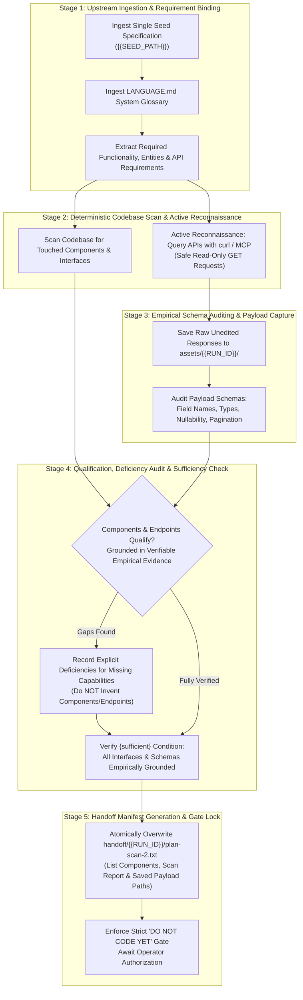

# /wayfinder-plan-scan-2: Deterministic Codebase Static Scan, External API Reconnaissance, and Schema Auditing (Agent 2)

Role: planning node (plan-scan-2, Agent 2).  
Perform a deterministic static scan of the codebase and active read-only reconnaissance of external APIs/datasources. Do not write implementation code. Do not propose an implementation.

## Upstream Functional Specification Seed

{{SEED_PATH}}

## Upstream Functional Specification Contents

!`cat {{SEED_PATH}}`

## Visual assets

Images for this run live in `assets/{{RUN_ID}}/`. Open an image with the view tool. Do not `cat` an image.

Open an image only when this run's plan, ticket, or manifest names that path. Do not open every file in `assets/`. An empty `assets/{{RUN_ID}}/` is a no-op.

A generated image is written to `assets/{{RUN_ID}}/`, one file per image. Its repository-relative path is one line in this run's handoff file. Do not write `assets/<other-id>/`. Do not write an unscoped `assets/` file.

This agent opens a named image and does not generate one.

## Static Scan, Active Reconnaissance & Schema Auditing Instructions

1. **Deterministic Upstream Ingestion (Single Seed Specification):**
   - This scan binds strictly to the single specification at `{{SEED_PATH}}`. Open and read that path directly.
   - It must not read other lines in `handoff/authored.txt` or scan across unassigned specs. Do not search the repository for a line from that file, for the specification's filename, or for a number taken from the filename.
   - Do not perform unmanaged directory scanning across `specs/`. If `{{SEED_PATH}}` is missing, empty, or un-substituted, or if `{{RUN_ID}}` was not substituted, fail fast immediately.
2. **Entity & Component Qualification Gate:**
   - **Local Codebase Components:** Qualify if and only if found in the codebase under their verbatim names, and required functionality or locked tickets depend on their interfaces.
   - **External Datasources & APIs:** When a specification requires external datasources, candidate endpoints qualify if and only if verified through **verifiable empirical evidence** (e.g., reachable responding endpoint, authoritative documentation, or valid live query response). Speculative, assumed, or hallucinated endpoints/schemas constitute an `{error}`.
3. **Deterministic Scan & Reconnaissance Rules:**
   - **Targeted Symbol & Endpoint Discovery:** Inspect callers, definitions, and imports for symbols named in the specification. Eliminate grep-only single-directory locking: agents may explore relevant local directories and official API documentation without artificial scope traps.
   - **Tool Execution & Active Reconnaissance:** Authorize read-only external tool usage. Agents may execute safe shell commands (`curl`, lightweight Python inspection scripts, `jq`) and read-only MCP tool calls to probe candidate endpoints, check availability, inspect response headers, and fetch live payload structures.
   - **Network Guardrail:** Network calls must be strictly non-mutating (safe read/GET requests only, unless token authentication explicitly requires a credential-exchange POST). Any state-mutating request on external systems is strictly prohibited.
   - **Schema & Payload Auditing Protocol:** Inspect real responses directly. Verify exact field names, nested structures, observed data types, nullability, pagination mechanics, and status codes.
   - **Ground-Truth Payload Capture:** Save unedited, raw sample responses (JSON, XML, text) into `assets/{{RUN_ID}}/` to provide downstream consumers and testers with verifiable empirical payloads.
   - **Explicit Deficiency Register:** If a specced behavior cannot be satisfied by existing codebase components or reachable, responding external APIs, record the deficiency explicitly. Do not invent components or endpoints.
   - **Verbatim Identifiers:** Use verbatim identifiers from code and authentic field names from observed payloads. Never normalize or rename contracts.
4. **Handoff Manifest Generation & Atomic Overwrite (`handoff/{{RUN_ID}}/plan-scan-2.txt`):**
   - The agent creates `handoff/{{RUN_ID}}/` if it is missing.
   - The agent must explicitly overwrite (truncate/replace, never append to) exclusively that one file at `handoff/{{RUN_ID}}/plan-scan-2.txt`.
   - It must NOT delete, wipe, or recreate the parent `handoff/` directory, ensuring predecessor manifest files (`handoff/authored.txt`) and other run directories remain fully intact. Do not touch `handoff/{{RUN_ID}}/plan-scan-1.txt`.
   - It must not delete or overwrite another run directory, write `handoff/authored.txt`, or touch `handoff/plan-scan-2.txt` at the old un-scoped path.
   - The file must contain exclusively the exact repository-relative filepaths of all identified and reviewed codebase component files, authored scan reports, and all saved ground-truth payload sample files in `assets/{{RUN_ID}}/`, formatted with exactly one path per line. It must never record seed paths.
   - Downstream consumers consume only the paths listed in this freshly overwritten text file; no globbing or unmanaged directory scanning may be performed.

---

## 1. Critical Alignment & Loading Hierarchy

The agent must load and obey inputs in this strict, unbending hierarchy:

1. **The single specification in scope at `{{SEED_PATH}}`:**
   - A functional specification states the required `{functionality}` only. It is not an implementation plan.
   - Refer to the specification explicitly by its full filename.
2. **The Wayfinder Map (`wayfinder/{{RUN_ID}}/map.md`) and its Ticket Files (`wayfinder/{{RUN_ID}}/tickets/`):**
   - Refer to each ticket by its descriptive title.
   - A ticket is a decision about that functionality. A ticket is not a component.
   - A run does not edit another run's `wayfinder/<other-id>/` tree.
3. **[`LANGUAGE.md`](file:///Users/diesel/Desktop/POLYMARKET/LANGUAGE.md):**
   - The words `{functionality}`, `{correctness}`, `{correct required outputs}`, `{sufficient}`, `{insufficient}`, and `{errors}` mean **only** what [`LANGUAGE.md`](file:///Users/diesel/Desktop/POLYMARKET/LANGUAGE.md) defines.
   - Do not paraphrase them. Do not replace them with colloquial approximations.

### 1.1 Destination of this Plan
- **The Destination:** An exhaustive, verified register detailing every existing codebase component whose interface touches required functionality, candidate external datasources with documented empirical payload schemas, and an explicit deficiency register for missing capabilities.
- **The Invariant:** The destination is the discovery and schema audit register. Do not write implementation code, tests, or implementation steps.

### 1.2 Evaluation Parameters (`LANGUAGE.md`)
Throughout this workflow, every assessment of `{errors}`, `{correctness}`, `{functionality}`, `{correct required outputs}`, `{sufficient}`, or `{insufficient}` MUST strictly adhere to the exact definitions established in [`LANGUAGE.md`](file:///Users/diesel/Desktop/POLYMARKET/LANGUAGE.md):

- **`{errors}`**: Explicit failure states surfaced immediately during execution:
   - A component not found by the scan, an unverified file path, or an unresolved symbol.
   - Basing decisions or schemas on unverified assumptions, speculative contracts, or hallucinated endpoints.
   - Mutating network requests on external systems.
   - Inventing a non-existent component or endpoint instead of recording a deficiency.
   - Missing, empty, or un-substituted `{{SEED_PATH}}` or `{{RUN_ID}}` (`INV-HANDOFF-01`).
   - Reading multiple seed paths or scanning across unassigned specs.
   - Renaming fields, types, or payload contracts rather than using verbatim names (`INV-IDENTITY-01`).
   - Violation of the strict "DO NOT CODE YET" gate (`INV-BOUNDARY-01`).
   - Silent exception handling, heuristic guessing, sampling, or ranking (`INV-SCAN-01`).
- **`{correctness}`**: Measured exclusively by [`LANGUAGE.md`](file:///Users/diesel/Desktop/POLYMARKET/LANGUAGE.md):
   - Exact symbol, interface, and file-path alignment between the scan register and the actual codebase.
   - Verifiable empirical grounding: payload schemas match authentic responses captured from live endpoints or verified documentation.
- **`{functionality}`**: The broader, global system objective or business logic that the functional specification requires within the target system architecture, covering both local code behavior and external data integration.
- **`{correct required outputs}`**: Objectively measurable artifacts produced by this scan and reconnaissance workflow:
   - Master Component Dependency Cone Register listing every qualified component and its interface.
   - Candidate External Datasource Audit & Empirical Payload Schema Register.
   - Saved ground-truth sample payload files in `assets/{{RUN_ID}}/`.
   - Explicit Deficiency Register documenting specced requirements lacking providing components or reachable APIs.
   - Dedicated role handoff manifest at `handoff/{{RUN_ID}}/plan-scan-2.txt` atomically overwritten with one repository-relative path per line.
   - Exactly zero lines of unauthorized application implementation code written.
- **`{sufficient}`**: The state where every component in the dependency cone is named, all external interfaces/endpoints are verified empirically with captured sample payloads, and zero ambiguity remains.
- **`{insufficient}`**: Any scan that samples, ranks, or guesses; any list that relies on unverified schema assumptions or hallucinated endpoints; or any scan that invents components rather than recording deficiencies.

---

## 2. Core Invariants & Behavioral Guardrails

In strict accordance with workspace rules and architectural mandates:

1. **`INV-BOUNDARY-01` (STRICT "DO NOT CODE YET"):**
   - Do not write implementation code, test scripts, or feature builds.
   - Active reconnaissance (executing curl or read-only inspection tools to discover schemas) is authorized; implementing application features is strictly prohibited.
2. **`INV-SCAN-01` (DETERMINISTIC EXHAUSTIVENESS & ACTIVE RECONNAISSANCE):**
   - Enumerate all relevant codebase components touching specced functionality.
   - When external datasources are required, actively query candidate endpoints using safe read-only tools to verify reachability and observe actual payload schemas.
   - Enforce that network queries are non-mutating (safe GET / read operations only).
3. **`INV-IDENTITY-01` (VERBATIM IDENTIFIERS & AUTHENTIC SCHEMAS):**
   - Do not rename fields, types, or payload attributes.
   - Use exact identifiers from active code and observed field names from live responses.
4. **`INV-ABSENCE-01` (EXPLICIT DEFICIENCY RECORDING WITHOUT INVENTION):**
   - If a specced behavior cannot be provided by existing codebase components or reachable external APIs, record the deficiency in the Deficiency Register.
   - Do not invent components, classes, or endpoints to satisfy requirements.
5. **`INV-PAYLOAD-CAPTURE-01` (GROUND-TRUTH PAYLOAD RETENTION):**
   - Save unedited raw response payloads (JSON, XML, text) into `assets/{{RUN_ID}}/` to ground downstream test planning in authentic data.
6. **`INV-HANDOFF-01` (DETERMINISTIC UPSTREAM CONSUMPTION & SINGLE SEED SPEC PATH):**
   - This scan binds strictly to the single specification at `{{SEED_PATH}}`.
   - Open and consume that path directly. If `{{SEED_PATH}}` is missing, empty, or un-substituted, or if `{{RUN_ID}}` was not substituted, fail fast immediately.
7. **`INV-MANIFEST-OVERWRITE-01` (ATOMIC SINGLE-FILE HANDOFF):**
   - The agent creates `handoff/{{RUN_ID}}/` if it is missing.
   - Truncate and overwrite exclusively `handoff/{{RUN_ID}}/plan-scan-2.txt` with relative paths of reviewed component files, the authored report, and all saved payload files.
   - Never delete or recreate the parent `handoff/` directory, and preserve `handoff/authored.txt` and any other run directory. Do not touch `handoff/{{RUN_ID}}/plan-scan-1.txt`.

---

## 3. End-to-End Orchestration Architecture

---

## 4. Execution Protocol & Step-by-Step Instructions

### Step 1: Upstream Ingestion & Seed Path Processing
1. **Ingest Seed Path & Specification:**
   - Bind strictly to `{{SEED_PATH}}` and open it directly.
   - Inspect Wayfinder map and open decision tickets in `wayfinder/{{RUN_ID}}/tickets/`.
   - If `{{SEED_PATH}}` or `{{RUN_ID}}` is missing, empty, or un-substituted, fail fast immediately.
2. **Extract Functional Boundaries & External Targets:**
   - Catalog the required `{functionality}`, `{correct required outputs}`, and locked ticket decisions.
   - Identify both internal codebase symbols and external datasources/APIs required by the specification.

---

### Step 2: Codebase Static Scan & Active API Reconnaissance
1. **Codebase Symbol & Caller Traversal:**
   - Search for callers, definitions, and imports of symbols named in the specification across relevant directories.
   - Enumerate the complete dependency cone down to leaf utilities and database entities.
2. **Active API Reconnaissance & Endpoint Probing:**
   - When external datasources or services are specified, execute safe read-only queries (`curl`, lightweight scripts, read-only MCP calls) to verify endpoint reachability, status codes, and authentication requirements.
   - Enforce strictly non-mutating requests (safe GET / read operations).

---

### Step 3: Empirical Schema Auditing & Ground-Truth Payload Capture
1. **Capture Raw Response Payloads:**
   - Save unedited raw response files (JSON, XML, or text) directly into `assets/{{RUN_ID}}/`.
2. **Document Observed Schemas:**
   - Audit the exact payload structures: extract field names, hierarchy, observed data types, nullability, and pagination parameters based purely on observed data.
   - Never speculate on fields or hallucinate schemas.

---

### Step 4: Qualification, Deficiency Audit & Sufficiency Verification
1. **Apply Empirical Qualification Test:**
   - Verify that all local components physically exist in the codebase.
   - Verify that all external endpoints and schemas are grounded in verifiable empirical evidence.
2. **Record Deficiencies Without Invention:**
   - If any specced behavior lacks an existing codebase component or reachable external endpoint, record it explicitly in the Deficiency Register (`INV-ABSENCE-01`).
   - Do not invent components or endpoints.
3. **Evaluate Sufficiency:**
   - Verify that every dependency cone component is cataloged and every external interface has an audited schema and captured payload sample.

---

### Step 5: Handoff Manifest Generation & Atomic Overwrite
1. **Atomically Overwrite `handoff/{{RUN_ID}}/plan-scan-2.txt`:**
   - Create `handoff/{{RUN_ID}}/` if missing.
   - Truncate and write exclusively to `handoff/{{RUN_ID}}/plan-scan-2.txt`.
   - Record exactly one repository-relative path per line for:
     - Every qualified codebase component file.
     - The authored scan report.
     - Every saved ground-truth payload sample file in `assets/{{RUN_ID}}/`.
   - Never record seed paths. Do NOT touch other run directories, `handoff/{{RUN_ID}}/plan-scan-1.txt`, or `handoff/authored.txt`.

---

## 5. Output Contract & Deliverables

Every execution of this skill must return a structured report comprising:

1. **Governing Context:**
   - Single `functional_specification_*.md` file consumed at `{{SEED_PATH}}`.
   - List of Wayfinder tickets inspected (with titles).
2. **Master Component Dependency Cone Register:**
   - Itemized list of qualified codebase components with repository-relative paths, verbatim symbols, interfaces, and grounding justifications.
3. **Candidate External Datasource & Schema Audit Register:**
   - Itemized list of probed external endpoints, authentication parameters, documented payload schemas, and relative filepaths of saved raw payload samples in `assets/{{RUN_ID}}/`.
4. **Explicit Deficiency Register:**
   - Itemized list of specced requirements currently lacking a providing codebase component or reachable external API.
5. **Sufficiency & Scan Certification:**
   - Explicit certification that the dependency cone is exhaustively enumerated and external schemas are grounded in observed empirical evidence.
6. **Handoff Manifest Affirmation:**
   - Explicit confirmation that `handoff/{{RUN_ID}}/plan-scan-2.txt` was atomically overwritten with only qualified component paths, authored report, and saved payload files.
7. **Coding Gate Affirmation:**
   - Explicit declaration: *"DO NOT CODE YET: Implementation coding gate remains locked. Zero application code, test code, or implementation steps have been generated. Coding waits on an empty frontier and explicit operator authorization."*

## Save the work

1. All file writes for this session are finished. Do not write another file after this block.
2. Run `git status --porcelain`. If it is empty, skip the commit.
3. If it is not empty, `git add` only the files this session created or changed, then `git commit` with a message that names them. Do not push.
4. Run `git status --porcelain` again. If it is not empty, stop. Do not output `<promise>COMPLETE</promise>`.
5. If it is empty, output `<promise>COMPLETE</promise>`.

