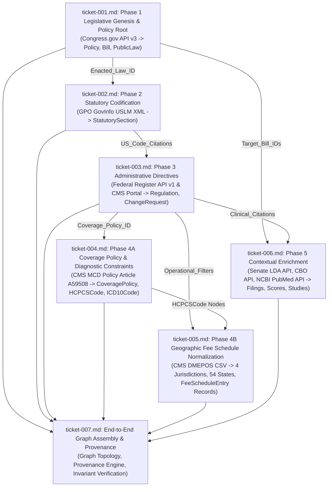

# Wayfinder Architectural Map: Multi-Tier Policy Knowledge Graph Data Pipeline and Schema Normalization

**Run ID:** `20261012T231057-024-zqga`  
**Governing Specification:** `functional_specification_003.md`  
**Planning Status:** Plan Fully Resolved  
**Planning Node:** `wayfinder-read-and-plan`

---

## 1. Destination

Construct an autonomous, deterministic, continuously hydratable data pipeline that ingests a single policy search parameter (`{Policy Keyword}`, e.g., `"LTA"`), queries authoritative federal legislative, statutory, regulatory, and healthcare billing data sources, and constructs an unbroken directed property graph. The graph connects the root policy keyword to its terminal pricing, coverage, and context nodes across five dependent tiers without heuristic fallback logic, synthetic defaults, or manual intervention.

The pipeline architecture enforces:
1. **Continuous Hydration & Idempotency:** Rooted in a deterministic `Policy` vertex (`POLICY-[keyword]`), supporting multi-policy coexistence via idempotent upserts (`MERGE` semantics) on composite primary keys across all shared federal entities.
2. **Deterministic Foreign-Key Traversal:** Upstream entities emit typed handoff contracts (`Target_Bill_IDs`, `Enacted_Law_ID`, `US_Code_Citations`, `Operational_Filters`, `Coverage_Policy_ID`, `Clinical_Citations`) that serve as mandatory query parameters for downstream stages, eliminating heuristic keyword bridging.
3. **Formal Coverage Policy Bridge:** Resolves the CMS Medicare Coverage Database (MCD) Policy Article (`CMS-MCD-A59508`) bridging administrative transmittals to covered HCPCS codes and allowable ICD-10 diagnostic codes, strictly prohibiting direct edges between `HCPCSCode` and `ICD10Code`.
4. **Complete Geographic & Jurisdictional Modeling:** Normalizes CMS DMEPOS multi-state fee schedule matrices across all 4 DME MAC Jurisdictions (`JURIS-DME-[A|B|C|D]`) and 54 States/Territories (`STATE-[state_code]`), unpivoting all 108 rural/non-rural fee columns into discrete `FeeScheduleEntry` nodes.
5. **Universal Edge Provenance:** Attaches non-nullable extraction metadata (`source_uri`, `selector`, `ingestion_timestamp`, `run_id`) to every edge in the property graph.
6. **Strict Invariant Enforcement:** Enforces `INV-FAIL-FAST`, `INV-NO-KEYWORD-BRIDGING`, `INV-UNBROKEN-ANCESTRY`, `INV-50-STATE-COMPLETENESS`, and `INV-IDEMPOTENT-UPSERTS`.
7. **Empirical Grounding:** Validates 100% of pipeline stages against the ground-truth empirical assets in `DataSources_Agent/assets/20261012T213134-452-7663/`.

---

## 2. Notes and System Conventions

- **Authoritative System Glossary:** All evaluation criteria (`{errors}`, `{correctness}`, `{functionality}`, `{correct required outputs}`, `{sufficient}`, `{insufficient}`) and domain terms (`{Policy Keyword}`, `{Target_Bill_IDs}`, `{Enacted_Law_ID}`, `{US_Code_Citations}`, `{Operational_Filters}`, `{Clinical_Citations}`) strictly adopt the definitions in `LANGUAGE.md`.
- **Deterministic Composite Primary Key Directory:**
  - `Policy`: `POLICY-[keyword]`
  - `Bill`: `BILL-[congress]-[type]-[number]`
  - `PublicLaw`: `PLAW-[congress]-[number]`
  - `StatutorySection`: `USC-[title]-[section]-[subsections]`
  - `Regulation`: `FR-[document_number]`
  - `ChangeRequest`: `CMS-CR-[cr_number]`
  - `CoveragePolicy`: `CMS-MCD-[article_id]`
  - `Jurisdiction`: `JURIS-DME-[A|B|C|D]`
  - `State`: `STATE-[state_code]`
  - `FeeScheduleEntry`: `FEE-[hcpcs]-[state]-[rural_flag]-[year]`
  - `HCPCSCode`: `HCPCS-[code]`
  - `ICD10Code`: `ICD10-[code]`
  - `LobbyingFiling`: `LDA-[filing_uuid]`
  - `CBOScore`: `CBO-[id]`
  - `LiteratureStudy`: `PUBMED-[pmid]`
- **Edge Provenance Contract:** Every edge must persist four non-nullable attributes: `source_uri` (string), `selector` (string), `ingestion_timestamp` (string, ISO-8601 UTC), and `run_id` (string).
- **Fail-Fast Halt Requirement:** Any stage failing to resolve a required foreign key or encountering an HTTP error / unparseable payload terminates execution immediately with structured error telemetry; silent fallbacks and mock data are prohibited.

---

## 3. Decisions So Far (Decision Ticket Register)

| Ticket | Human-Readable Ticket Name | Scope / Tier | Status | Blocked By |
|---|---|---|---|---|
| [`ticket-001.md`](tickets/ticket-001.md) | Phase 1 Legislative Genesis, Bill Resolution, and Root Policy Ingestion Schema | Tier 1: Legislative Origins | RESOLVED | None (Root) |
| [`ticket-002.md`](tickets/ticket-002.md) | Phase 2 Statutory Codification Delta and USLM XML Structural Parsing Schema | Tier 2: Statutory Codification | RESOLVED | `ticket-001.md` |
| [`ticket-003.md`](tickets/ticket-003.md) | Phase 3 Administrative Rulemaking, Regulatory Execution, and Directive Extraction Schema | Tier 3: Administrative Directives | RESOLVED | `ticket-002.md` |
| [`ticket-004.md`](tickets/ticket-004.md) | Phase 4A Coverage Policy Ingestion, Medical Coding, and Diagnostic Indication Constraints Schema | Tier 4A: Coverage Policy & Coding | RESOLVED | `ticket-003.md` |
| [`ticket-005.md`](tickets/ticket-005.md) | Phase 4B Geographic Fee Schedule Normalization, Multi-State Unpivoting, and Jurisdictional Topology Schema | Tier 4B: Geographic Fee Schedule | RESOLVED | `ticket-003.md`, `ticket-004.md` |
| [`ticket-006.md`](tickets/ticket-006.md) | Phase 5 Contextual Enrichment: Advocacy Disclosures, Budget Scores, and Clinical Literature Schema | Tier 5: Contextual Enrichment | RESOLVED | `ticket-001.md`, `ticket-003.md` |
| [`ticket-007.md`](tickets/ticket-007.md) | End-to-End Graph Assembly, Edge Provenance Contract, Idempotent Upserts, and Graph Connectivity Verification | Cross-Tier Assembly & Invariants | RESOLVED | `ticket-001.md` through `ticket-006.md` |

---

## 4. Dependency DAG

