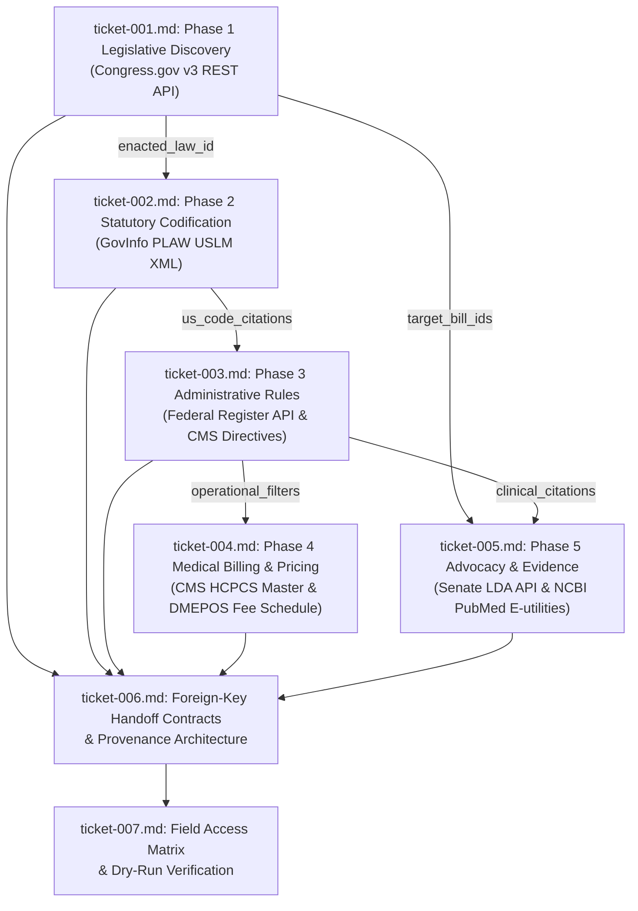

# Wayfinder Architectural Map: Data Source Audit, Payload Feasibility, and Foreign-Key Handoff Pipeline

**Run ID:** `20261012T213134-452-7663`  
**Root Specification:** `functional_specification_001.md`  
**Status:** In Progress / Plan Locked  
**Planning Node:** `wayfinder-read-and-plan`

---

## 1. Destination

Construct an autonomous, zero-seed foreign-key discovery and data extraction pipeline that takes a single policy keyword string parameter (such as `"LTA"`) and mechanically discovers, verifies, and chains all downstream entities across federal legislation, statutory codification, administrative rulemaking, medical coding/pricing, and evidentiary context. The architecture enforces unbroken provenance, immutable composite primary keys, deterministic exact-match querying, and fail-fast termination without heuristic fallbacks or ungrounded mock data.

---

## 2. Notes and System Conventions

- **Authoritative System Glossary:** All evaluation criteria, qualifiers, and domain taxonomy strictly adopt the standards defined in `LANGUAGE.md`.
- **Zero Pre-Populated Lookups:** Hardcoded bill numbers, public law IDs, U.S. Code sections, procedure codes, or fee schedules are prohibited.
- **Fail-Fast Enforcement:** Any phase failing to extract its required downstream foreign key halts pipeline execution immediately with structured error telemetry.
- **Immutable Composite Identifiers:**
  - Bill: `BILL-[congress]-[type]-[number]`
  - Public Law: `PLAW-[congress]-[number]`
  - Statute: `USC-[title]-[section]-[subsection]`
  - Regulation: `CFR-[title]-[part]-[section]`
  - Directive: `CR-[transmittal_number]`
  - Medical Code: `HCPCS-[code]`
  - Diagnosis: `ICD10-[code]`
  - Literature: `PMID-[id]`
- **Field Access Classifications:**
  - *Direct Path (Native Keys):* Explicit key-value pairs in JSON or dedicated XML tags/attributes accessible via direct pointer paths.
  - *Structural Traversal (Derived Keys):* Embedded markup elements isolated via deterministic XPath or DOM traversal.

---

## 3. Decisions So Far (Decision Ticket Register)

| Ticket | Human-Readable Ticket Name | Phase / Scope | Status | Blocked By |
|---|---|---|---|---|
| [`ticket-001.md`](tickets/ticket-001.md) | Phase 1 Legislative Bill Discovery Datasource Selection, Query Mechanics, and Handoff Payload Schema | Phase 1: Legislative Genesis | RESOLVED | None (Root) |
| [`ticket-002.md`](tickets/ticket-002.md) | Phase 2 Statutory Codification Markup Source Selection, Document Traversal, and Citation Extraction Schema | Phase 2: Statutory Codification | RESOLVED | `ticket-001.md` |
| [`ticket-003.md`](tickets/ticket-003.md) | Phase 3 Administrative Rules and Directives Registry Selection, Authority Querying, and Filter/Citation Schema | Phase 3: Administrative Rulemaking | RESOLVED | `ticket-002.md` |
| [`ticket-004.md`](tickets/ticket-004.md) | Phase 4 Medical Billing, Coverage Determination, and Regional Fee Schedule Schema Reconciliation | Phase 4: Medical Billing & Pricing | RESOLVED | `ticket-003.md` |
| [`ticket-005.md`](tickets/ticket-005.md) | Phase 5 Advocacy, Budget Estimates, and Peer-Reviewed Literature Context Integration Schema | Phase 5: Advocacy & Evidence | RESOLVED | `ticket-001.md`, `ticket-003.md` |
| [`ticket-006.md`](tickets/ticket-006.md) | Foreign-Key Pipeline Handoff Contracts, Immutable Composite Key Formats, and Lineage Tracking Architecture | Pipeline Architecture & Handoff | RESOLVED | `ticket-001.md` through `ticket-005.md` |
| [`ticket-007.md`](tickets/ticket-007.md) | Field Access Matrix, Payload Feasibility Audit, and Dry-Run Verification Specification | Audit Verification & Matrix | RESOLVED | `ticket-006.md` |

---

## 4. Dependency DAG

