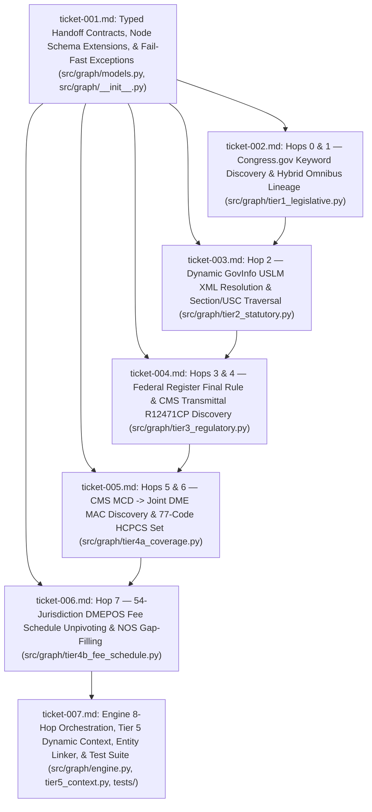

# Wayfinder Architectural Roadmap: Authoritative Cross-Agency Policy Traversal & Linkage Pipeline

**Run ID:** `20261013T225035-656-0beg`  
**Seed Specification:** [`functional_specification_013.md`](file:///Users/diesel/Desktop/LAG/.sandcastle/worktrees/agent-plan-20261013T225035-656-0beg/functional_specification_013.md)  
**Taxonomy Reference:** [`LANGUAGE.md`](file:///Users/diesel/Desktop/LAG/.sandcastle/worktrees/agent-plan-20261013T225035-656-0beg/LANGUAGE.md)  

---

## Destination

Transform the LAG policy ingestion pipeline (`src/graph/`) from a fixture-bound, hardcoded conditional script into an autonomous, deterministic 8-hop policy traversal engine. Given solely a runtime `{Policy Keyword}` (e.g., `"LTA"`, `"Lymphedema Treatment Act"`, `"IVIG"`), the engine traverses official U.S. government publication schemas across Congress.gov, GovInfo USLM XML, the Federal Register API, CMS Transmittals, CMS Medicare Coverage Database (with automatic alternative-source routing to Joint DME MAC Administrative Publications when MCD returns 404), the CMS HCPCS Alpha-Numeric Code Set, and the CMS DMEPOS Fee Schedule across all 54 U.S. jurisdictions. Every stage boundary enforces a strict Pydantic handoff contract (`extra="forbid"`) and raises a dedicated fail-fast exception (`LegislativeResolutionError` through `FeeScheduleIngestionError`) when any required upstream key, citation, or query hit is missing.

---

## Notes

1. **Empirical Asset & Endpoint Verification:**
   - **Hops 0 & 1 (Congress.gov):** `H.R. 3630` (*Lymphedema Treatment Act*, 117th Congress) has an empty `laws` array (`[]`) in `stage1_congress_bill_hr3630.json` because it was incorporated into the omnibus *Consolidated Appropriations Act, 2023* (`H.R. 2617`, `stage1_congress_bill_hr2617.json`), which carries `laws: [{"number": "117-328", "type": "Public Law"}]` enacted `2022-12-29`. Therefore, Hop 1 must execute the hybrid check (`bill.laws` $\to$ fallback to `relatedBills[*].laws`) and construct the linear omnibus chain `BILL-117-hr-3630 -[:INCORPORATED_INTO]-> BILL-117-hr-2617 -[:ENACTED_AS]-> PLAW-117-328` without emitting a false direct `BILL-117-hr-3630 -[:ENACTED_AS]-> PLAW-117-328` shortcut edge.
   - **Hop 2 (GovInfo USLM XML):** `phase2_uslm_plaw_117_328_sec4133.xml` and `phase2_govinfo_plaw_117publ328.xml` contain `<section identifier="/us/pl/117/328/dFF/tIV/stD/s4133">` (`Section 4133`, *"Medicare coverage of lymphedema compression treatment items"*) and `<section identifier="/us/pl/117/328/dFF/tIV/stD/s4134">` (`Section 4134`, *"Medicare coverage of items and services relating to administration of intravenous immune globulin"*). Section 4133 amends five distinct U.S. Code provisions via `<ref href="/us/usc/...">` and `<quotedContent>`: `42 U.S.C. 1395x(s)(2)(JJ)`, `42 U.S.C. 1395x(mmm)`, `42 U.S.C. 1395l(a)(1)(GG)`, `42 U.S.C. 1395m(z)`, and `42 U.S.C. 1395w-3(a)(2)(D)`, with effective date `<date date="2024-01-01">January 1, 2024</date>`.
   - **Hop 3 (Federal Register):** `phase3_federal_register_search_1395x.json` and `phase3_federal_register_rule_2023_24455.json` resolve Final Rule `2023-24455` (`88 FR 77676`, Docket `CMS-1780-F`, RIN `0938-AV03`, effective `2024-01-01`), referencing `42 CFR Part 409, 410, 414, 424, 484, 488, 489` and codifying LTA rules at `42 CFR 410.36`, `414.1600`, `414.1650`, and `414.1690`.
   - **Hop 4 (CMS Transmittals):** In the CMS Transmittals index (`2023-transmittals` / `2024-transmittals`), Change Request `13286` (Pub. `100-04`, Medicare Claims Processing Manual) was initially issued as Transmittal `R12379CP` (Nov 22, 2023) and superseded by active Transmittal `R12471CP` (Jan 23, 2024), establishing Benefit Category `LC` and Pricing Indicator `40` (replacing the inaccurate hardcoded `"12349"` in existing `tier3_regulatory.py`).
   - **Hop 5 (Coverage Guidance Alternative Source Discovery):** `stage4a_cms_mcd_a59508_web_probe.html` returns `<title>404</title>`, confirming that `A59508` is not a valid CMS MCD article. When the primary CMS MCD lookup returns 404/empty, Hop 5 routes to the secondary authoritative publisher—Joint DME MAC Administrative Publications (CGS / Noridian)—producing `coverage_guidance_id="DME-MAC-PUB-LYMPHEDEMA"`, `publisher_type="DME_MAC_JOINT_PUBLICATION"`, `publication_title="Lymphedema Compression Treatment Items – Correct Coding and Billing"`, and all 4 qualifying ICD-10-CM diagnosis codes (`["I89.0", "I97.2", "I97.89", "Q82.0"]`).
   - **Hop 6 (77-Code HCPCS Alpha-Numeric Set):** The official CMS January 2024 Alpha-Numeric HCPCS file (`HCPC2024_JAN_ANWEB_v4.txt`) defines 77 procedure codes (`A6520`–`A6610`) with `BETOS == "O1L"` and `Pricing Indicator == "40"`: 70 standard codes with national DMEPOS fee schedule rates and 7 custom/not-otherwise-specified (NOS) codes (`A6549`, `A6559`, `A6560`, `A6561`, `A6584`, `A6593`, `A6609`) priced under `LOCAL_CONTRACTOR_PRICING`.
   - **Hop 7 (54-Jurisdiction DMEPOS Fee Schedule Unpivot):** `phase4_cms_dmepos_fee_schedule_2024.zip` (`DMEPOS_JAN.csv`) and `phase4_cms_dmepos_lc_category.csv` unpivot the 70 national-rate `LC` codes across all 54 U.S. states/territories (`NR` and `R` columns = 108 columns, `70 * 54 = 3,780` `FeeScheduleRateNode`s and `7,560` national `FeeScheduleRecord`s) while accounting for the 7 NOS/custom codes in `ReimbursementHandoff.unpriced_custom_codes` (`7 * 108 = 756` local-contractor `FeeScheduleRecord`s).

---

## Decisions So Far

| Ticket | Scope | Architectural Decision Locked |
| :--- | :--- | :--- |
| [ticket-001.md](file:///Users/diesel/Desktop/LAG/.sandcastle/worktrees/agent-plan-20261013T225035-656-0beg/wayfinder/20261013T225035-656-0beg/tickets/ticket-001.md) | Handoff Contracts, Node Schema, & Exceptions | Define all 8 Pydantic handoff contracts (`LegislativeHandoff`, `StatutoryHandoff`, `RegulatoryHandoff`, `OperationalHandoff`, `CoverageHandoff`, `CodingHandoff`, `FeeScheduleRecord`, `ReimbursementHandoff`) with `extra="forbid"`, all 8 fail-fast exceptions (`LegislativeResolutionError` through `FeeScheduleIngestionError`), and backward-compatible `Tier1Handoff`–`Tier3Handoff` subclasses in [`src/graph/models.py`](file:///Users/diesel/Desktop/LAG/.sandcastle/worktrees/agent-plan-20261013T225035-656-0beg/src/graph/models.py). |
| [ticket-002.md](file:///Users/diesel/Desktop/LAG/.sandcastle/worktrees/agent-plan-20261013T225035-656-0beg/wayfinder/20261013T225035-656-0beg/tickets/ticket-002.md) | Hops 0 & 1 (`src/graph/tier1_legislative.py`) | Replace hardcoded keyword branching and silent `Exception` suppression with dynamic Congress.gov bill discovery (Hop 0) and hybrid `bill.laws` $\to$ `relatedBills[*].laws` omnibus resolution (Hop 1), emitting linear omnibus edges `BILL-117-hr-3630 -[:INCORPORATED_INTO]-> BILL-117-hr-2617 -[:ENACTED_AS]-> PLAW-117-328`. |
| [ticket-003.md](file:///Users/diesel/Desktop/LAG/.sandcastle/worktrees/agent-plan-20261013T225035-656-0beg/wayfinder/20261013T225035-656-0beg/tickets/ticket-003.md) | Hop 2 (`src/graph/tier2_statutory.py`) | Derive GovInfo USLM package ID (`PLAW-{congress}publ{number}`) dynamically from `LegislativeHandoff.public_law_id`, structurally score `<section>` elements by `<heading>`/`<content>` against policy tokens, and extract `/us/pl/117/328/dFF/tIV/stD/s4133` plus all 5 amended USC citations (`1395x(s)(2)(JJ)`, `1395x(mmm)`, `1395l(a)(1)(GG)`, `1395m(z)`, `1395w-3(a)(2)(D)`) and `effective_date="2024-01-01"`. |
| [ticket-004.md](file:///Users/diesel/Desktop/LAG/.sandcastle/worktrees/agent-plan-20261013T225035-656-0beg/wayfinder/20261013T225035-656-0beg/tickets/ticket-004.md) | Hops 3 & 4 (`src/graph/tier3_regulatory.py`) | Query Federal Register search results (`phase3_federal_register_search_1395x.json`) by statutory authority to resolve Final Rule `2023-24455` (`88 FR 77676`, `CMS-1780-F`, `0938-AV03`) for `RegulatoryHandoff` (Hop 3), and resolve CMS Change Request `13286` with active Transmittal `R12471CP` (superseding `R12379CP`), Manual `100-04`, Benefit Category `LC`, and Pricing Indicator `40` for `OperationalHandoff` (Hop 4). |
| [ticket-005.md](file:///Users/diesel/Desktop/LAG/.sandcastle/worktrees/agent-plan-20261013T225035-656-0beg/wayfinder/20261013T225035-656-0beg/tickets/ticket-005.md) | Hops 5 & 6 (`src/graph/tier4a_coverage.py`) | Probe CMS MCD (`stage4a_cms_mcd_a59508_web_probe.html`), detect the HTTP 404, and route to Joint DME MAC Administrative Publication `DME-MAC-PUB-LYMPHEDEMA` with all 4 ICD-10-CM codes (`I89.0`, `I97.2`, `I97.89`, `Q82.0`) for `CoverageHandoff` (Hop 5); extract all 77 `LC` (`O1L` / `PI 40`) HCPCS codes (`A6520`–`A6610`) for `CodingHandoff` (Hop 6). |
| [ticket-006.md](file:///Users/diesel/Desktop/LAG/.sandcastle/worktrees/agent-plan-20261013T225035-656-0beg/wayfinder/20261013T225035-656-0beg/tickets/ticket-006.md) | Hop 7 (`src/graph/tier4b_fee_schedule.py`) | Unpivot the 70 national-rate `LC` codes across all 54 DMEPOS jurisdictions (`NR` and `R`) while explicitly reconciling the 7 custom/NOS codes (`A6549`, `A6559`, `A6560`, `A6561`, `A6584`, `A6593`, `A6609`) under `LOCAL_CONTRACTOR_PRICING` in `ReimbursementHandoff`. |
| [ticket-007.md](file:///Users/diesel/Desktop/LAG/.sandcastle/worktrees/agent-plan-20261013T225035-656-0beg/wayfinder/20261013T225035-656-0beg/tickets/ticket-007.md) | Orchestration, Context, & Tests (`src/graph/engine.py`, `tier5_context.py`, `tests/`) | Wire all 8 hop handoffs into `PropertyGraphEngine.build_pipeline` (`self.handoffs`), remove hardcoded node IDs from `tier5_context.py`, align `entity_linker.py`, and expand `tests/test_graph_pipeline.py` to verify every hop, handoff contract, and fail-fast exception. |

---

## Autonomous 8-Hop Traversal Routing Map

| Hop | Stage Name | Mechanism Classification | Authoritative Source & Endpoint / Asset | Input Contract | Extracted Pointers & Output Handoff Contract | Fail-Fast Exception |
| :--- | :--- | :--- | :--- | :--- | :--- | :--- |
| **0** | Keyword $\to$ Bill Discovery | **Search / Discovery Hop** | Congress.gov API v3 (`GET /v3/bill?query={Policy Keyword}&sort=relevancy`) + `stage1_congress_bill_hr3630.json` | Runtime `policy_keyword: str` | `Target_Bill_ID = "BILL-117-hr-3630"` (`bills[*].congress`, `type`, `number`, `title`) | `LegislativeResolutionError` |
| **1** | Bill $\to$ Enacted Public Law | **Hybrid Hop (Direct / Discovery)** | Congress.gov API v3 (`GET /v3/bill/{c}/{t}/{n}` & `/relatedbills`) + `stage1_congress_bill_hr2617.json` | `Target_Bill_ID` | `LegislativeHandoff`: `introduced_bill_id="BILL-117-hr-3630"`, `enacting_bill_id="BILL-117-hr-2617"`, `public_law_id="PLAW-117-328"`, `congress=117`, `enacted_date="2022-12-29"` | `EnactedLawNotFoundError` |
| **2** | Law $\to$ Statutory Section & USC | **Direct Linkage + Structural Traversal** | GovInfo USLM XML (`PLAW-{c}publ{n}` / `phase2_uslm_plaw_117_328_sec4133.xml`, `phase2_govinfo_plaw_117publ328.xml`) | `LegislativeHandoff` | `StatutoryHandoff`: `uslm_section_path="/us/pl/117/328/dFF/tIV/stD/s4133"`, `statute_section_number="4133"`, `amended_usc_citations` (5 USC citations), `effective_date="2024-01-01"` | `StatutorySectionNotFoundError` |
| **3** | Statute $\to$ Final Rule | **Search / Discovery Hop** | Federal Register API v1 (`GET /api/v1/documents.json`) + `phase3_federal_register_search_1395x.json` & `phase3_federal_register_rule_2023_24455.json` | `StatutoryHandoff` | `RegulatoryHandoff`: `fr_document_number="2023-24455"`, `fr_citation="88 FR 77676"`, `docket_id="CMS-1780-F"`, `rin="0938-AV03"`, `cfr_references`, `effective_date="2024-01-01"` | `RegulatoryRuleResolutionError` |
| **4** | Final Rule $\to$ Operational Directive (CR) | **Search / Discovery Hop** | CMS Transmittals (`2023-transmittals` / `2024-transmittals` index, Pub. `100-04`) | `StatutoryHandoff` + `RegulatoryHandoff` | `OperationalHandoff`: `change_request_number="13286"`, `active_transmittal_number="R12471CP"`, `superseded_transmittal_numbers=["R12379CP"]`, `benefit_category_code="LC"`, `pricing_indicator_code="40"` | `OperationalDirectiveMissingError` |
| **5** | Directive $\to$ Clinical Coverage Guidance | **Alternative Source Discovery** | Primary: CMS MCD (`stage4a_cms_mcd_a59508_web_probe.html` $\to$ 404) $\to$ Secondary: Joint DME MAC Administrative Publication | `OperationalHandoff` | `CoverageHandoff`: `coverage_guidance_id="DME-MAC-PUB-LYMPHEDEMA"`, `publisher_type="DME_MAC_JOINT_PUBLICATION"`, `qualifying_icd10_codes=["I89.0", "I97.2", "I97.89", "Q82.0"]` | `ClinicalCoverageMissingError` |
| **6** | Directive $\to$ HCPCS Code Set | **Direct Linkage** | CMS Alpha-Numeric HCPCS (`HCPC2024_JAN_ANWEB_v4.txt` / CR 13286 attachment + `phase4_cms_dmepos_lc_category.csv`) | `OperationalHandoff` + `CoverageHandoff` | `CodingHandoff`: `benefit_category_code="LC"`, `betos_code="O1L"`, `hcpcs_codes` (77 codes `A6520`–`A6610`), `code_descriptions`, `code_pricing_indicators` (`"40"`) | `CodingTableMismatchError` |
| **7** | HCPCS Codes $\to$ 54-Jurisdiction Fee Matrix | **Direct Linkage** | CMS DMEPOS Fee Schedule (`phase4_cms_dmepos_fee_schedule_2024.zip` / `DMEPOS_JAN.csv`, `phase4_cms_dmepos_lc_category.csv`) | `CodingHandoff` | `ReimbursementHandoff`: `fee_schedule_release="2024-JAN"`, `jurisdiction_count=54`, `records` (8,316 records), `unpriced_custom_codes` (7 NOS codes) | `FeeScheduleIngestionError` |

---

## DAG

