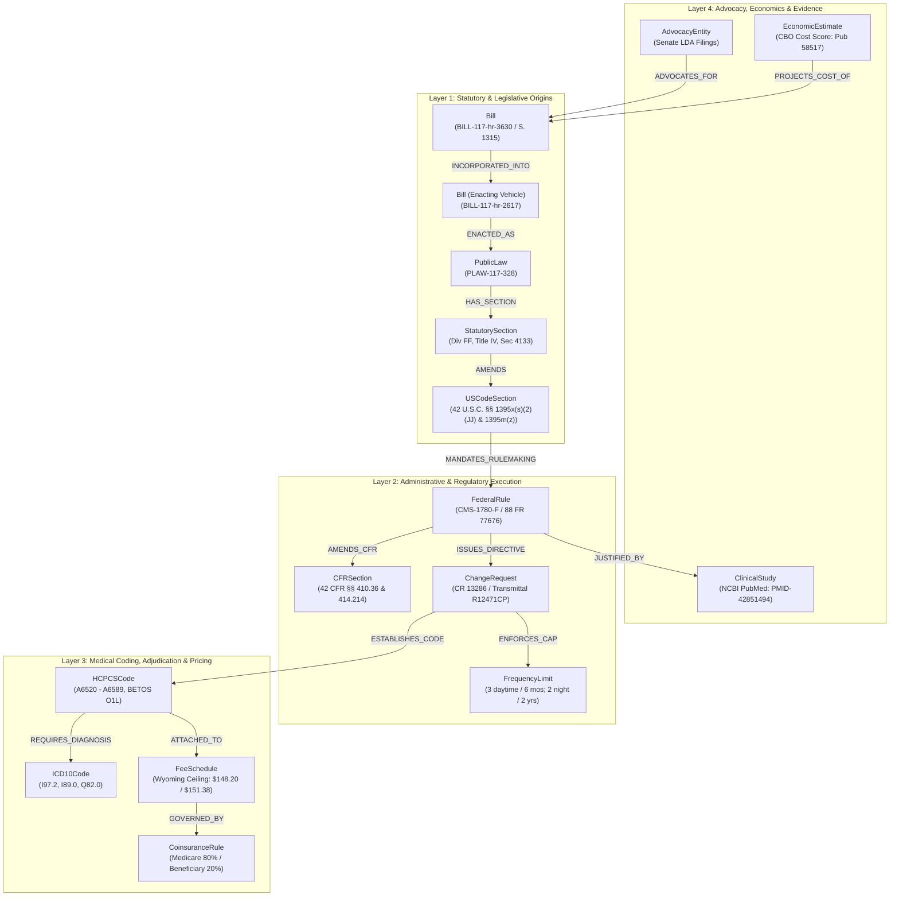

Listed directory legacy
Listed directory LAG
Ran command: `git status`
Ran command: `git log -n 3 --stat`
Viewed functional_specification_002.md:1-58
Ran command: `git show 25cc283~1:legacy/knowledge_graph.md | head -n 80`

# Functionality Understanding Check: Constructing the Policy-to-Adjudication Knowledge Graph

---

## 1. Task Objective & Context

Now that all data sources, payload schemas, structural XPath selectors, and foreign-key contracts have been empirically audited and archived in [`DataSources_Agent/`](file:///Users/diesel/Desktop/LAG/DataSources_Agent), the project transitions to the next phase:

> **Constructing a deterministic, fully resolved Knowledge Graph (KG) from the empirical payloads to serve as authoritative, hallucination-free retrieval context for an LLM agent.**

In accordance with `/functionality-understanding-check` and `RULE[user_global]`, all code generation and file modifications are halted (**DO NOT CODE YET**). Below is the comprehensive statement of task understanding.

---

## 2. Statement of Desired Functionality (`{functionality}`)

The desired `{functionality}` is the construction of an interconnected, multi-layered Graph Database / Knowledge Graph that transforms raw legislative markup, administrative registries, medical coding datasets, and contextual literature into an **unbroken, mathematically bound semantic graph**.

This graph serves as the deterministic grounding layer for an LLM agent/chatbot. When a user asks a clinical, operational, or legal question (e.g., the Wyoming secondary lymphedema scenario illustrated in [`example_output.md`](file:///Users/diesel/Desktop/LAG/example_output.md)), the LLM agent retrieves and traverses concrete graph nodes and edges rather than attempting probabilistic text generation or live scraping.

---

## 3. Knowledge Graph Entity-Relationship Architecture

The knowledge graph models the complete **Policy-to-Adjudication Lifecycle** across four vertical tiers, establishing explicit parent-child authority chains:

### 3.1. Node Specifications Grounded in Verified Assets
Every node type must ingest raw data directly from the captured empirical payloads in [`DataSources_Agent/assets/20261012T213134-452-7663/`](file:///Users/diesel/Desktop/LAG/DataSources_Agent/assets/20261012T213134-452-7663):

| Node Label | Identifier Format (`LANGUAGE.md`) | Ingested Source Payload | Core Properties |
|---|---|---|---|
| `Bill` | `BILL-[congress]-[type]-[number]` | [`phase1_govinfo_bill_117hr3630.xml`](file:///Users/diesel/Desktop/LAG/DataSources_Agent/assets/20261012T213134-452-7663/phase1_govinfo_bill_117hr3630.xml) | `bill_id`, `congress`, `type`, `number`, `title`, `sponsor`, `status` |
| `PublicLaw` | `PLAW-[congress]-[number]` | [`phase2_govinfo_plaw_117publ328_summary.json`](file:///Users/diesel/Desktop/LAG/DataSources_Agent/assets/20261012T213134-452-7663/phase2_govinfo_plaw_117publ328_summary.json) | `law_id`, `congress`, `number`, `title`, `date_enacted` |
| `StatutorySection` | Composite path pointer | [`phase2_uslm_plaw_117_328_sec4133.xml`](file:///Users/diesel/Desktop/LAG/DataSources_Agent/assets/20261012T213134-452-7663/phase2_uslm_plaw_117_328_sec4133.xml) | `section_number` ("4133"), `division` ("FF"), `title` ("IV"), `heading` |
| `USCodeSection` | `USC-[title]-[section]-[subsection]` | Derived from Section 4133 USLM XML | `citation` ("42 U.S.C. 1395x(s)(2)(JJ)"), `title` (42), `section` ("1395x") |
| `FederalRule` | Federal Register Document ID | [`phase3_federal_register_cms_final_rule_metadata.json`](file:///Users/diesel/Desktop/LAG/DataSources_Agent/assets/20261012T213134-452-7663/phase3_federal_register_cms_final_rule_metadata.json) | `citation` ("88 FR 77676"), `docket_id` ("CMS-1780-F"), `effective_date` ("2024-01-01") |
| `ChangeRequest` | `CR-[transmittal_number]` | Regulatory execution directives | `cr_number` ("13286"), `policy_category` ("214" / "LC") |
| `FrequencyLimit` | Unique limit hash | Rule preamble / CR 13286 | `item_type`, `max_units`, `interval_months` (3 daytime/6 mos, 2 night/2 yrs) |
| `HCPCSCode` | `HCPCS-[code]` | [`phase4_cms_dmepos_lc_category.csv`](file:///Users/diesel/Desktop/LAG/DataSources_Agent/assets/20261012T213134-452-7663/phase4_cms_dmepos_lc_category.csv) | `code` ("A6583"), `description`, `jurisdiction` ("D"), `category` ("LC") |
| `ICD10Code` | `ICD10-[code]` | [`phase4_nlm_icd10cm_search_lymphedema.json`](file:///Users/diesel/Desktop/LAG/DataSources_Agent/assets/20261012T213134-452-7663/phase4_nlm_icd10cm_search_lymphedema.json) | `code` ("I97.2"), `description` ("Postmastectomy lymphedema syndrome") |
| `FeeSchedule` | Composite `[code]-[state]-[year]` | [`phase4_cms_dmepos_lc_category.csv`](file:///Users/diesel/Desktop/LAG/DataSources_Agent/assets/20261012T213134-452-7663/phase4_cms_dmepos_lc_category.csv) | `state` ("WY"), `allowed_ceiling` ($151.38 / $148.20), `coinsurance_patient` (20%) |
| `ClinicalStudy` | `PMID-[id]` | [`phase5_pubmed_esummary_clinical_citation.json`](file:///Users/diesel/Desktop/LAG/DataSources_Agent/assets/20261012T213134-452-7663/phase5_pubmed_esummary_clinical_citation.json) | `pmid` ("42851494"), `title`, `authors`, `journal`, `clinical_evidence` |
| `EconomicEstimate` | CBO Publication ID | [`phase5_cbo_cost_estimates_congress_gov.json`](file:///Users/diesel/Desktop/LAG/DataSources_Agent/assets/20261012T213134-452-7663/phase5_cbo_cost_estimates_congress_gov.json) | `publication_id` ("58517"), `agency` ("CBO"), `release_date` ("2022-09-23") |
| `AdvocacyEntity` | Senate Filing UUID | [`phase5_lda_lobbying_filings.json`](file:///Users/diesel/Desktop/LAG/DataSources_Agent/assets/20261012T213134-452-7663/phase5_lda_lobbying_filings.json) | `registrant` ("The D Major Group"), `client` ("Lymphedema Advocacy Group") |

---

## 4. Expected Correct Required Outputs (`{correct required outputs}`)

When implemented, the Knowledge Graph component must produce an objectively measurable output state:

1. **Deterministic Structured Graph Dataset:**
   - A fully validated graph export (e.g., normalized JSON-LD, SQLite Graph Tables, or Neo4j Cypher ingestion format).
   - Contains all nodes and relationship edges instantiated from the 22 archived payload files in `DataSources_Agent/assets/`.
2. **Unbroken Bidirectional Provenance:**
   - Every procedure node (e.g., `HCPCS-A6583`) and pricing node (Wyoming Fee Schedule) must maintain an unbroken traversal path back to `USC-42-1395x-s(2)(JJ)`, `PLAW-117-328`, and `BILL-117-hr-3630`.
   - Disconnected or unanchored nodes violate system invariants and must be purged.
3. **Structured Context Retrieval Protocol:**
   - Traversal queries designed for LLM prompts that deterministically package subgraph context (Statutory Authority $\rightarrow$ Regulatory Cap $\rightarrow$ Billing Code $\rightarrow$ Allowed Price $\rightarrow$ Evidentiary Justification) for any specific user question.

---

## 5. Sufficiency State & Pre-Implementation Alignment

- **Documentation & Data State:** The captured payloads and schema classifications are **`{sufficient}`** under [`LANGUAGE.md`](file:///Users/diesel/Desktop/LAG/LANGUAGE.md). All necessary attributes, values, and foreign-key links are physically present in the workspace.
- **Architectural Decision Needed Before Coding:**
  To proceed to implementation planning, we need alignment on your preferred target architecture:
  - **Storage Format:** (e.g., Local SQLite relational graph with JSON views, NetworkX / Python in-memory Graph, or JSON-LD graph bundle).
  - **Interface:** How the LLM agent will invoke or query the graph (e.g., CLI query tool, Python helper module, or formatted Markdown context bundle).

**Gate Affirmation:** All coding remains locked (**DO NOT CODE YET**). Understanding is established. Ready for your architectural direction or specification.