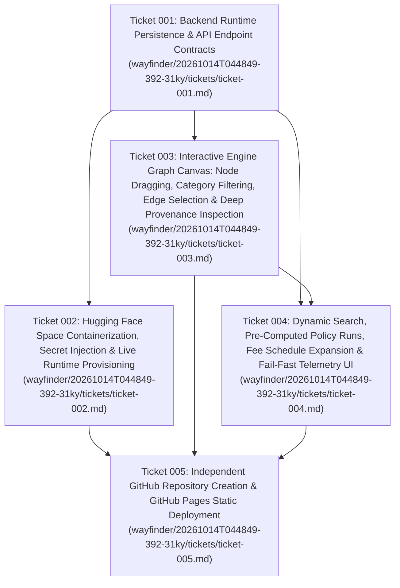

# Wayfinder Architectural Roadmap (`20261014T044849-392-31ky`)

- **Run ID:** `20261014T044849-392-31ky`
- **Governing Specification:** [`functional_specification_016.md`](file:///Users/diesel/Desktop/LAG/.sandcastle/worktrees/agent-plan-20261014T044849-392-31ky/functional_specification_016.md)
- **Glossary Reference:** [`LANGUAGE.md`](file:///Users/diesel/Desktop/LAG/.sandcastle/worktrees/agent-plan-20261014T044849-392-31ky/LANGUAGE.md)

---

## 1. Destination

Deliver the complete, production-verified dual-platform deployment architecture for the interactive 8-hop legislative/healthcare engine web showcase defined in `functional_specification_016.md`:
1. **Frontend Presentation Layer (`https://luisp1028.github.io/lag-policy-engine-showcase/`):** A standalone, interactive static React/TypeScript/D3 web application published via an independent public GitHub repository (`LuisP1028/lag-policy-engine-showcase`) with its own clean Git history, zero committed secrets, full 8-hop canvas interaction (pan, zoom, click, select, node drag, category filter, edge inspection, deep node provenance inspection), pre-computed policy run selection (`LTA`, `IVIG`), dynamic backend query dispatch, 54-jurisdiction filtering (including `GU`), fee schedule expansion toggle, execution status indicators (`idle`, `querying`, `streaming`, `completed`, `error`), and explicit fail-fast backend status telemetry.
2. **Backend Engine Runtime Layer (`https://choppedcheese-lag-policy-engine.hf.space`):** A persistent FastAPI backend service deployed to Hugging Face Spaces (`ChoppedCheese/lag-policy-engine`, Docker SDK on port `7860`) exposing `/api/health`, `/api/graph/topology`, `/api/entities/{primary_key}`, `/api/entities/resolve`, `/api/graphrag/subgraph`, and `/api/graphrag/query`, backed by a deterministic embedded graph store (`NEO4J_URI="embedded://exports/lta_knowledge_graph.json"`) in cloud containers while preserving full `bolt://localhost:7687` Neo4j compatibility locally, with CORS enabled for `https://luisp1028.github.io` and upstream API keys injected strictly via Hugging Face Space Secrets.

---

## 2. Notes & Platform Telemetry

- **Authenticated GitHub Account:** `LuisP1028` (`gh auth status` verified with `repo`, `workflow`, `read:org`, `gist` scopes).
- **Dedicated Showcase Repository:** `LuisP1028/lag-policy-engine-showcase` $\rightarrow$ GitHub Pages URL: `https://luisp1028.github.io/lag-policy-engine-showcase/`.
- **Authenticated Hugging Face Account:** `ChoppedCheese` (`mcp_huggingface_hf_whoami` verified with `repo.write`, `repo.content.read`, `inference.serverless.write`).
- **Dedicated Hugging Face Space:** `ChoppedCheese/lag-policy-engine` (`sdk: docker`, `app_port: 7860`) $\rightarrow$ Direct Runtime URL: `https://choppedcheese-lag-policy-engine.hf.space`.
- **Pre-Computed Policy Artifacts:** `exports/lta_knowledge_graph.json` (3,875 nodes, 7,593 edges across 17 entity categories and 18 relationship types) and `exports/ivig_knowledge_graph.json` (183 nodes, 289 edges).

---

## 3. Ticket Dependency DAG

---

## 4. Decisions So Far

1. **[Ticket 001 — Backend Runtime Persistence & API Endpoint Contracts](file:///Users/diesel/Desktop/LAG/.sandcastle/worktrees/agent-plan-20261014T044849-392-31ky/wayfinder/20261014T044849-392-31ky/tickets/ticket-001.md) (Resolved):**
   - Extended `HealthResponse` (`src/api/models.py`) with `loaded_policies: List[str]`, `uptime_seconds: float`, and `storage_backend: str` while preserving `status="ok"`, `neo4j_connected=True`, and `timestamp`.
   - Added `EntityInspectionResponse` (`src/api/models.py`) and `GET /api/entities/{primary_key:path}` (`src/api/routes.py`) returning native keys, derived keys, `text_excerpt`, `citations`, incident `relationships`, and deduplicated `provenance` (`source_uri`, `selector`, `run_id`, `ingestion_timestamp`).
   - Created `src/graph/embedded_driver.py` (`EmbeddedGraphDriver`) integrated into `Neo4jSyncEngine` (`src/graph/neo4j_sync.py`) when `NEO4J_URI` starts with `embedded://` (e.g. `embedded://exports/lta_knowledge_graph.json`), enabling zero-daemon cloud execution on Hugging Face Spaces while keeping `bolt://localhost:7687` untouched for local Neo4j runs.
   - Configured `CORSMiddleware` (`src/api/server.py`) to allow `https://luisp1028.github.io` and `*.github.io` / `*.hf.space`.
2. **[Ticket 002 — Hugging Face Space Containerization, Secret Injection & Live Runtime Provisioning](file:///Users/diesel/Desktop/LAG/.sandcastle/worktrees/agent-plan-20261014T044849-392-31ky/wayfinder/20261014T044849-392-31ky/tickets/ticket-002.md) (Resolved):**
   - Locked `Dockerfile` (Python 3.11-slim, UID 1000, port `7860`, `NEO4J_URI="embedded://exports/lta_knowledge_graph.json"`) and `requirements.txt` at repository root with zero embedded credentials.
   - Locked `src/deploy/deploy_hf_space.py` to create/update `ChoppedCheese/lag-policy-engine`, inject `HF_TOKEN`, `HUGGINGFACE_API_KEY`, and `CONGRESS_API_KEY` via the Hugging Face Space Secrets API, push the clean container bundle, and verify `https://choppedcheese-lag-policy-engine.hf.space/api/health`.
3. **[Ticket 003 — Interactive Engine Graph Canvas: Node Dragging, Category Filtering, Edge Selection & Deep Provenance Inspection](file:///Users/diesel/Desktop/LAG/.sandcastle/worktrees/agent-plan-20261014T044849-392-31ky/wayfinder/20261014T044849-392-31ky/tickets/ticket-003.md) (Resolved):**
   - Locked pointer node dragging (`fx`/`fy` simulation pinning) and point-to-segment edge click hit-testing (`findEdgeAtEvent`) in `src/frontend/src/components/GraphCanvas.tsx`.
   - Locked `selectedEdge`, `filterCategory`, `searchQuery`, `includeFeeSchedules`, `dataSourceMode`, `executionStatus`, and `backendState` in `src/frontend/src/context/GraphSyncContext.tsx`.
   - Locked both Deep Node Inspection (fetching `/api/entities/{primary_key}` for `text_excerpt`, `citations`, native/derived keys, and all 4 provenance attributes) and Edge Inspection (displaying relationship `label`, directional linkage `source_pk -> label -> target_pk`, and `source_uri`, `selector`, `run_id`, `ingestion_timestamp`) in `src/frontend/src/components/NodeDetailDrawer.tsx`.
4. **[Ticket 004 — Dynamic Search, Pre-Computed Policy Runs, Fee Schedule Expansion & Fail-Fast Telemetry UI](file:///Users/diesel/Desktop/LAG/.sandcastle/worktrees/agent-plan-20261014T044849-392-31ky/wayfinder/20261014T044849-392-31ky/tickets/ticket-004.md) (Resolved):**
   - Locked `src/frontend/src/utils/apiConfig.ts` (`getApiBaseUrl()` resolving `VITE_API_BASE_URL` or `https://choppedcheese-lag-policy-engine.hf.space` on `github.io` and `""` on `localhost`) and `src/frontend/src/utils/precomputedTopology.ts` (filtering bundled `public/runs/lta_knowledge_graph.json` and `public/runs/ivig_knowledge_graph.json` for zero-latency pre-computed run mode).
   - Locked `FilterToolbar.tsx` and `App.tsx` controls for pre-computed run selection, policy keyword, 54-state/territory filter, DME MAC contractor filter, 17-category filter, lexical search input, fee schedule expansion toggle, execution status badge (`idle`, `querying`, `streaming`, `completed`, `error`), and fail-fast backend cold-start/error alert banner.
5. **[Ticket 005 — Independent GitHub Repository Creation & GitHub Pages Static Deployment](file:///Users/diesel/Desktop/LAG/.sandcastle/worktrees/agent-plan-20261014T044849-392-31ky/wayfinder/20261014T044849-392-31ky/tickets/ticket-005.md) (Resolved):**
   - Locked `base: process.env.VITE_BASE_PATH || './'` in `src/frontend/vite.config.ts`.
   - Locked `src/deploy/deploy_github_pages.py` and `src/deploy/deploy_all.py` to build the static bundle, verify zero secrets exist, initialize and push the independent GitHub repository `LuisP1028/lag-policy-engine-showcase` (`main` and `gh-pages` branches with `.nojekyll` and GitHub Pages workflow), enable GitHub Pages via REST API, verify HTTP 200 OK across `https://luisp1028.github.io/lag-policy-engine-showcase/` and `https://choppedcheese-lag-policy-engine.hf.space`, and record deployment metadata in `src/deploy/deployment_manifest.json`.

---

## 5. Open Frontier / Unresolved Fog

None. All 5 architectural decision tickets are resolved and grounded in verified codebase schemas and authenticated platform endpoints.
