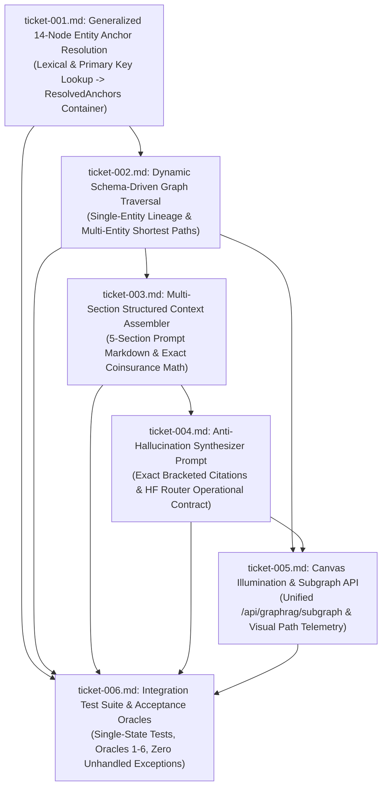

# Wayfinder Architectural Map: Dynamic Schema-Driven GraphRAG Traversal

**Governing Specification:** `functional_specification_005.md`  
**Run ID:** `20261013T155419-714-niq1`  
**Planning Status:** Resolved Frontier  
**Planning Node:** `wayfinder-read-and-plan`  
**Taxonomy Reference:** [`LANGUAGE.md`](file:///Users/diesel/Desktop/LAG/LANGUAGE.md)  

---

## 1. Destination

Replace the rigid, three-template query routing architecture in `src/graphrag/traversal.py` with a dynamic, schema-driven **Graph Retrieval-Augmented Generation (GraphRAG)** engine capable of traversing any domain entity or combination of entities ($N \ge 1$) across the 14 Neo4j node types without unhandled exceptions or crashes.

The planned architectural enhancements achieve the following system goals:
1. **Dynamic Schema-Driven Traversal ($N \ge 1$):** Eliminates all hardcoded `if/elif` template checks. Single-entity queries (e.g. `STATE-NY`, single procedure codes, or canvas node clicks) dynamically resolve their legal, contractor, administrative, and fee lineage (`INV-UNBROKEN-ANCESTRY`). Multi-entity queries ($N \ge 2$) dynamically discover connecting shortest paths across the property graph.
2. **Clinical Indication Mediation (`INV-NO-KEYWORD-BRIDGING`):** Procedure codes (`HCPCSCode`) and diagnosis codes (`ICD10Code`) connect exclusively through an authorizing `CoveragePolicy` article. Zero direct procedure-to-diagnosis edges exist or are traversed.
3. **Fail-Fast Error Boundaries (`INV-FAIL-FAST`):** Immediate `HTTP 400` errors with structured `EntityResolutionError` or `TraversalError` payloads are returned when entities are unindexed (e.g. "Atlantis", "diabetes") or paths are disconnected, strictly eliminating silent try/catch suppression or synthetic fallbacks.
4. **Structured Five-Section Context Assembly:** Organizes retrieved graph subgraphs into five authoritative sections (Program Authority, Contractor & Region, Clinical Criteria, Fees and Patient Costs, Data Sources) with exact 20% patient coinsurance calculations and zero hardcoded fallback strings.
5. **Exact-Citation Anti-Hallucination LLM Synthesis:** Instructs the remote Hugging Face language model (`meta-llama/Llama-3.1-8B-Instruct`) to quote exact bracketed primary keys (e.g. `[CMS-MCD-A59508]`, `[PLAW-117-328]`, `[JURIS-DME-A]`), exact reimbursement dollar figures, and official statutory/regulatory citations.
6. **Synchronized Visual Canvas Illumination:** Returns comprehensive active node primary keys and directed edge keys to illuminate the traversed path in amber/gold on the browser canvas and center the viewport on the active path.

---

## 2. Notes and System Conventions

- **Authoritative System Glossary (`LANGUAGE.md`):**
  - `{errors}`: Explicit failure states surfaced immediately during execution (stack traces, unhandled exceptions, compilation failures, non-zero exit codes, fatal timeouts, or schema mismatch).
  - `{correctness}`: Precise local logic, schema alignment, and contract fidelity across modified modules without logical flaws.
  - `{functionality}`: Dynamic schema-driven GraphRAG traversal replacing the three hardcoded `if/elif` templates; supports any domain entity across 14 node types ($N \ge 1$); traces single-entity legal and administrative lineage; finds connecting paths between two or more entities; respects `INV-NO-KEYWORD-BRIDGING`, `INV-UNBROKEN-ANCESTRY`, `INV-FAIL-FAST`, `INV-PROVENANCE-COMPLETENESS`; context assembly with zero hardcoded defaults; LLM synthesis quoting bracketed primary keys, dollar amounts, and legal citations; synchronized canvas illumination.
  - `{correct required outputs}`: Objectively measurable artifacts produced: updated roadmap at `wayfinder/20261013T155419-714-niq1/map.md`, atomic decision tickets `ticket-001.md` through `ticket-006.md`, Master Component-to-Edit Matrix at `wayfinder/20261013T155419-714-niq1/matrix.md`, and deterministic handoff manifest at `handoff/20261013T155419-714-niq1/wayfinder-read-and-plan.txt`.
  - `{sufficient}`: State of documentation where absolutely no ambiguity remains; all touched file paths, line ranges, endpoints, schemas, data structures, and edge cases are defined.
  - `{insufficient}`: Any planning state where critical context is missing or instructions are vague.
- **System Invariants:**
  - `INV-UNBROKEN-ANCESTRY`: Zero tolerance for orphaned nodes. Every entity connects to authorizing policies.
  - `INV-NO-KEYWORD-BRIDGING`: Prohibits direct procedure-to-diagnosis connections; all clinical indications must be mediated through an official `CoveragePolicy`.
  - `INV-FAIL-FAST`: Halts immediately with structured diagnostics if an entity is missing or ungrounded; synthetic defaults and probabilistic guesses are strictly forbidden.
  - `INV-PROVENANCE-COMPLETENESS`: Every edge retains `source_uri`, `selector`, `ingestion_timestamp`, and `run_id`.
  - `INV-BOUNDARY-01`: Planning session writes no application implementation code, test modifications enacting changes, or migrations.
  - `INV-HANDOFF-01`: Deterministic handoff manifest overwrite listing exclusively `functional_specification_005.md`, run decision tickets, map, and matrix.

---

## 3. Decisions So Far (Decision Ticket Register)

| Ticket | Human-Readable Ticket Name | Scope / Component | Status | Blocked By |
|---|---|---|---|---|
| [`ticket-001.md`](tickets/ticket-001.md) | Generalized 14-Node Entity Anchor Resolution and Fail-Fast Validation Specification | `src/graphrag/entity_linker.py`, `src/graphrag/models.py` | RESOLVED | None (Root) |
| [`ticket-002.md`](tickets/ticket-002.md) | Dynamic Schema-Driven Graph Traversal Engine ($N \ge 1$) Specification | `src/graphrag/traversal.py` | RESOLVED | `ticket-001.md` |
| [`ticket-003.md`](tickets/ticket-003.md) | Multi-Section Structured Context Assembler Specification | `src/graphrag/context_assembler.py` | RESOLVED | `ticket-002.md` |
| [`ticket-004.md`](tickets/ticket-004.md) | Anti-Hallucination Synthesizer System Prompt and Citation Grounding Specification | `src/graphrag/synthesizer.py` | RESOLVED | `ticket-003.md` |
| [`ticket-005.md`](tickets/ticket-005.md) | Canvas Illumination Telemetry, Subgraph API, and Canvas Synchronization Specification | `src/api/routes.py`, `src/frontend/` | RESOLVED | `ticket-002.md`, `ticket-003.md`, `ticket-004.md` |
| [`ticket-006.md`](tickets/ticket-006.md) | Integration Test Suite and Acceptance Oracle Verification Specification | `tests/test_graphrag_pipeline.py`, `tests/test_api_endpoints.py` | RESOLVED | `ticket-001.md` through `ticket-005.md` |

---

## 4. Dependency DAG

---

## 5. Not Yet Specified (Fog of War)

- Cross-payer commercial policy coverage harmonization (e.g. UnitedHealthcare, Aetna, Cigna) scheduled for downstream policy expansion modules.
- Client-side WebGL acceleration for graph visualizer rendering beyond 10,000 active nodes.

---

## 6. Out of Scope

- Unconstrained free-form Cypher text-to-query generation by open-weight models.
- DDL modifications altering existing Neo4j uniqueness constraints or node primary keys.
- Ad-hoc manual fallback queries that bypass the dynamic topological traversal engine.
