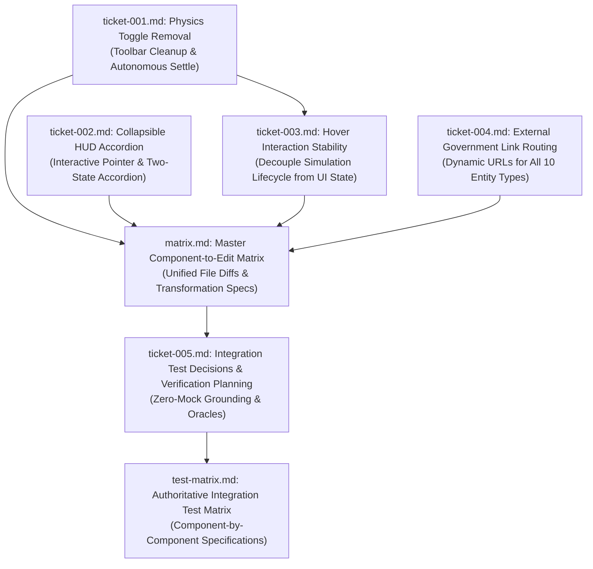

# Wayfinder Architectural Map: Visualizer UI Controls, Canvas Stability, and External Government Links

**Governing File:** `functional_specification_006.md`  
**Run ID:** `20261013T165618-008-wcap`  
**Planning Status:** Resolved Frontier  
**Planning Mode:** Wayfinder Specification & Decision Mapping  
**Taxonomy Reference:** `LANGUAGE.md`

---

## 1. Destination

Deconstruct and resolve all architectural, behavioral, and component decisions required to implement the four frontend visualizer upgrades defined in [`functional_specification_006.md`](file:///Users/diesel/Desktop/LAG/functional_specification_006.md):
1. **Toolbar Cleanup:** Permanently remove the redundant "Freeze Physics" / "Unfreeze" button from the top navigation bar while establishing autonomous force simulation stabilization upon initial load and filter updates.
2. **Collapsible Blueprint HUD Accordion:** Refactor the static Blueprint Telemetry HUD overlay into an interactive accordion supporting Collapsed State (`◈ BLUEPRINT HUD [▼]`) and Expanded State (`◈ LAG KNOWLEDGE BLUEPRINT HUD [▲]`), eliminating layout overlap with toolbar controls.
3. **Canvas Node Hover Stability:** Eliminate the reactive re-instantiation loop that repels nodes when hovered or selected by isolating the D3 simulation lifecycle from transient UI states.
4. **100% Live Government External Links:** Replace static mock and broken links with dynamic, property-derived links navigating to verified, live government web portals across all 10 entity types.

---

## 2. Notes and System Conventions

- **Authoritative Vocabulary:** All evaluation parameters (`{errors}`, `{correctness}`, `{functionality}`, `{correct required outputs}`, `{sufficient}`, `{insufficient}`) strictly adhere to [`LANGUAGE.md`](file:///Users/diesel/Desktop/LAG/LANGUAGE.md).
- **Core System Rules:**
  - `INV-FAIL-FAST`: Fail immediately upon missing or ungrounded data; synthetic fallbacks and arbitrary timeouts are strictly prohibited.
  - `INV-NO-KEYWORD-BRIDGING`: Policy lineage and entity relationships are strictly preserved.
  - `INV-MAP-01`: All tickets use monotonic counters within this run directory (`wayfinder/20261013T165618-008-wcap/tickets/ticket-NNNN.md`).
  - `INV-HANDOFF-01`: Deterministic handoff manifest generated at `handoff/20261013T165618-008-wcap/wayfinder-read-and-plan.txt`.

---

## 3. Decisions So Far (Decision Ticket Register)

| Ticket | Human-Readable Ticket Name | Scope / Tier | Status | Blocked By |
|---|---|---|---|---|
| [`ticket-001.md`](tickets/ticket-001.md) | Removal of Physics Toggle Button & Autonomous Force Simulation Stabilization | Navigation & Simulation Controls | RESOLVED | None (Root) |
| [`ticket-002.md`](tickets/ticket-002.md) | Collapsible Blueprint HUD Accordion Component Architecture & State Management | Visualizer Telemetry HUD | RESOLVED | None (Independent UI) |
| [`ticket-003.md`](tickets/ticket-003.md) | Canvas Node Hover Interaction Stability & Reactive Dependency Isolation | Canvas Event Bus & Lifecycle | RESOLVED | `ticket-001.md` |
| [`ticket-004.md`](tickets/ticket-004.md) | Systematic External Government Link Routing & Dynamic Parameter Resolution | Node Detail Drawer Provenance | RESOLVED | None (Independent Component) |
| [`ticket-005.md`](tickets/ticket-005.md) | Integration Test Decision Mapping, Payload Admissibility Governance, and Verification Architecture | Integration Testing & Verification | RESOLVED | `ticket-001.md`, `ticket-002.md`, `ticket-003.md`, `ticket-004.md` |

---

## 4. Dependency DAG

---

## 5. Not Yet Specified (Fog of War)

- Mobile touch-screen gesture support (pinch-to-zoom) on devices without mouse pointers.
- Offline cached mirror for government documents during federal domain outages.

---

## 6. Out of Scope

- Modifying the underlying backend Neo4j schema or GraphRAG Python pipeline.
- Modifying CSS stylesheets for non-visualizer application routes.
