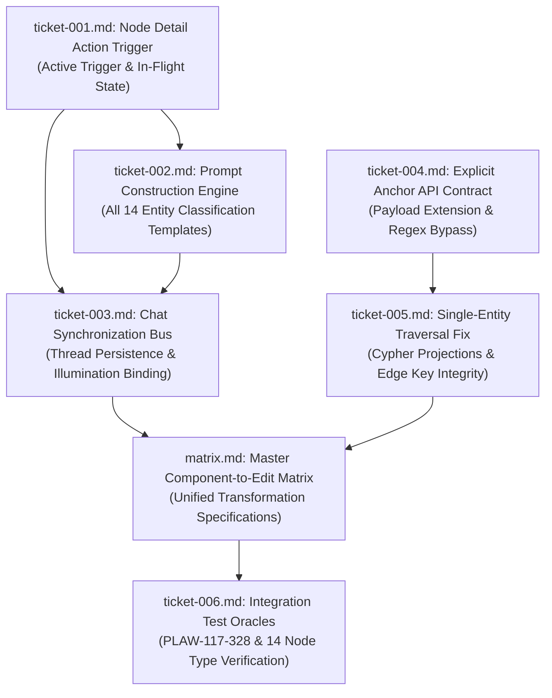

# Wayfinder Architectural Map: Node Detail Contextual Inquire Action and Targeted GraphRAG Execution

**Governing File:** `functional_specification_007.md`  
**Run ID:** `20261013T172426-897-pj8g`  
**Planning Status:** Resolved Frontier  
**Planning Mode:** Wayfinder Specification & Decision Mapping  
**Taxonomy Reference:** `LANGUAGE.md`

---

## 1. Destination

Deconstruct and resolve all architectural, state synchronization, backend API, traversal, and verification decisions required to implement the one-click contextual inquiry workflow specified in [`functional_specification_007.md`](file:///Users/diesel/Desktop/LAG/functional_specification_007.md):
1. **One-Click Execution & Workflow:** Transform the passive "INQUIRE IN GRAPHRAG CHAT" button into an active trigger that opens the drawer, constructs an entity-specific prompt, dispatches the query, renders assistant response with telemetry, and illuminates canvas topology.
2. **Deterministic Entity Classification Prompts:** Implement template generation across all 14 entity types incorporating the bracketed primary key.
3. **Unified Chat Synchronization Bus:** Centralize messages, loading state, and dispatch execution in `GraphSyncContext` so successive node inquiries append distinct turns without wiping previous history.
4. **Explicit Anchor Transmission Contract:** Extend `GraphRAGQueryRequest` to transmit `primary_key`, enabling the backend to bypass natural language regex guessing.
5. **Single-Entity Traversal & Edge Integrity:** Eliminate corrupted `UNKNOWN` edge keys in `_execute_single_general_traversal` via explicit Cypher projections, and expand context assembly across all 14 entity types.
6. **Comprehensive Test Oracles:** Establish automated verification covering `PLAW-117-328` statutory inquiries, all 14 entity types, and fast failure boundaries.

---

## 2. Notes and System Conventions

- **Authoritative Vocabulary:** All evaluation parameters (`{errors}`, `{correctness}`, `{functionality}`, `{correct required outputs}`, `{sufficient}`, `{insufficient}`) strictly adhere to [`LANGUAGE.md`](file:///Users/diesel/Desktop/LAG/LANGUAGE.md).
- **Core System Invariants:**
  - `INV-FAIL-FAST`: Fail immediately upon missing or ungrounded data; synthetic fallbacks and silent exception suppressions are strictly prohibited.
  - `INV-NO-KEYWORD-BRIDGING`: Policy lineage and entity relationships are strictly preserved.
  - `INV-MAP-01`: All tickets use monotonic counters within this run directory (`wayfinder/20261013T172426-897-pj8g/tickets/ticket-NNNN.md`).
  - `INV-HANDOFF-01`: Deterministic handoff manifest generated at `handoff/20261013T172426-897-pj8g/wayfinder-read-and-plan.txt`.

---

## 3. Decisions So Far (Decision Ticket Register)

| Ticket | Human-Readable Ticket Name | Scope / Tier | Status | Blocked By |
|---|---|---|---|---|
| [`ticket-001.md`](tickets/ticket-001.md) | Node Detail Action Trigger, Event Workflow, and In-Flight State Management | Drawer Trigger & Button State | RESOLVED | None (Root UI) |
| [`ticket-002.md`](tickets/ticket-002.md) | Deterministic Entity Classification Prompt Construction Engine | Classification Prompt Templates | RESOLVED | `ticket-001.md` |
| [`ticket-003.md`](tickets/ticket-003.md) | Bidirectional Chat Synchronization Bus and Conversation Thread State Management | Chat Synchronization & History | RESOLVED | `ticket-001.md`, `ticket-002.md` |
| [`ticket-004.md`](tickets/ticket-004.md) | Explicit Anchor Transmission Contract and Backend Bypass Architecture | Backend API & Linker Bypass | RESOLVED | None (Root Backend) |
| [`ticket-005.md`](tickets/ticket-005.md) | Single-Entity Neighborhood Traversal and Canvas Edge Key Reconstruction | Neo4j Cypher Traversal & Context | RESOLVED | `ticket-004.md` |
| [`ticket-006.md`](tickets/ticket-006.md) | Integration Test Architecture, Oracle Grounding, and End-to-End Verification | Test Oracles & Regression Prevention | RESOLVED | `ticket-001.md`, `ticket-002.md`, `ticket-003.md`, `ticket-004.md`, `ticket-005.md` |

---

## 4. Dependency DAG

---

## 5. Not Yet Specified (Fog of War)

- Streaming LLM token delivery (Server-Sent Events) for real-time word-by-word assistant text rendering.
- User-customizable prompt templates in visualizer configuration drawer.

---

## 6. Out of Scope

- Modifying the underlying Neo4j schema labels or database graph relationships.
- Adding third-party chat notification services (webhooks, email alerts).
