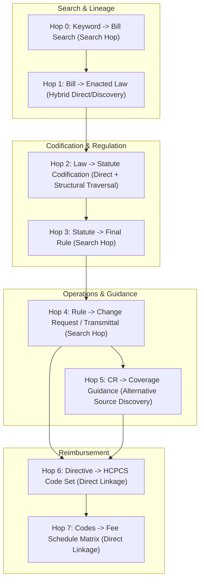

# Functional Specification: Authoritative Cross-Agency Policy Traversal & Linkage Pipeline

**Document ID:** `functional_specification_013.md`  
**Status:** Requirements Specification  
**Implementation Guidance:** Strictly Prohibited (DO NOT CODE YET)  
**Taxonomy Reference:** [LANGUAGE.md](file:///Users/diesel/Desktop/LAG/LANGUAGE.md)  
**Historical References:** [functional_specification_011.md](file:///Users/diesel/Desktop/LAG/functional_specification_011.md), [functional_specification_012.md](file:///Users/diesel/Desktop/LAG/functional_specification_012.md)  

---

## 1. Objective and Problem Statement

This specification defines the functional requirements for an autonomous, deterministic policy traversal engine. Given solely a runtime `{Policy Keyword}` (e.g., `"LTA"`), the engine must traverse official United States government publication systems (Congress.gov, GovInfo / GPO, Federal Register, CMS Transmittals, Coverage Guidance, and Fee Schedules) to construct an unbroken, verifiable lineage from legislative origin to operational reimbursement.

### The Problem
The current system architecture suffers from two critical architectural defects:
1. **Hardcoded Pipeline Fixtures & Bypassed Handoffs:** Stages ignore incoming handoff contracts and instead read static local files or inject pre-baked constants (`H.R. 3630`, `Section 4133`, `CR 13286`, `A59508`, `12349`), preventing dynamic execution across arbitrary policy keywords.
2. **False Traversal Assumptions:** The existing codebase presumes naive 1:1 direct foreign key pointers across agency silos where official publication structures require distinct traversal mechanisms (e.g., assuming a bill directly links to a public law when it was incorporated into an omnibus vehicle; assuming a regulation points forward to an operational directive; assuming coverage articles reside in the CMS Medicare Coverage Database when published as contractor joint instructions).

### Desired Solution
The application must execute an abstract **Traversal Routing Map**:
- Explicitly map each hop by **Source Endpoint $\to$ Source Field/Path $\to$ Next Entity Identifier**.
- Categorize each hop into its operational mechanism:
  1. **Direct Linkage:** Key-value navigation via explicit foreign keys or manifest arrays.
  2. **Search / Discovery Hop:** Cross-corpus semantic or citation search querying an authoritative endpoint for an unlinked downstream directive.
  3. **Alternative Source Discovery:** Routing to decentralized or secondary authoritative publishers when a centralized primary repository lacks standard entries.
- Enforce strict fail-fast error handling when expected fields or query hits are absent.

---

## 2. Taxonomy and Evaluation Parameters

All evaluations must adhere strictly to the definitions in [LANGUAGE.md](file:///Users/diesel/Desktop/LAG/LANGUAGE.md):

* **`{errors}`:** Stack traces, HTTP connection failures, API schema validation errors, missing required fields, unresolvable citation strings, or unhandled exceptions occurring during agency endpoint discovery.
* **`{correctness}`:** Every identifier, citation, transmittal number, CFR part, procedure code, and reimbursement dollar amount precisely matches the official text and metadata published by the authoritative government publisher.
* **`{functionality}`:** The complete end-to-end traversal resolves from an initial string query to actionable billing/reimbursement parameters through verifiable, document-backed linkage.
* **`{correct required outputs}`:** An unbroken routing map and generated knowledge graph of verified entity nodes and directed edges spanning Policy Keyword $\to$ Introduced Bill $\to$ Enacting Bill $\to$ Public Law $\to$ Statutory Codification $\to$ Regulation Final Rule $\to$ Change Request / Transmittal $\to$ Coverage Guidance $\to$ HCPCS Codes $\to$ State Fee Schedule Rates.
* **`{sufficient}`:** Complete specification of data sources, endpoint query contracts, navigation rules, extractable key pointers, and failure boundaries without implementation-level code sketches or architectural workarounds.
* **`{insufficient}`:** Incomplete linkage definitions, missing query parameters, unaddressed missing document endpoints, or reliance on undocumented external services.

---

## 3. High-Level Comparison: Current Pipeline vs. Autonomous Routing Architecture

| Traversal Step | Current Pipeline State (Broken / Hardcoded) | Required Autonomous Routing Mechanism |
| :--- | :--- | :--- |
| **0. Keyword $\to$ Bill** | Hardcoded conditional `if clean_kw == "LTA": ... elif clean_kw == "IVIG": ...`. Discards all other inputs. | **Search / Discovery Hop:** Query Congress.gov API search endpoint with `{Policy Keyword}` to discover candidate legislative vehicle(s). |
| **1. Bill $\to$ Enacting Law** | Falsely links `H.R. 3630 -[:ENACTED_AS]-> PLAW-117-328`. Over-the-counter hardcoded fallback on rate-limit error. | **Hybrid Hop (Direct / Discovery):** If candidate bill has populated `laws`, extract direct key. If un-enacted, traverse `relatedbills` to identify enacting omnibus vehicle, then extract direct `laws` key. |
| **2. Law $\to$ Statutory Section** | Always opens static local file `stage2_uslm_plaw_117_328_sec4133.xml`. Ignores incoming Public Law ID in handoff. | **Direct Linkage + Structural Traversal:** Fetch GovInfo USLM XML package by Law ID. Traverse table of contents / headings matching policy scope to extract section tags and amended U.S. Code citations. |
| **3. Statute $\to$ Final Rule** | Always opens static local file `stage3_federal_register_rule_2023_24455.json`. Ignores incoming USC citation. | **Search / Discovery Hop:** Query Federal Register Search API using statutory section name / USC citation and agency filter to identify the enacting administrative Final Rule. |
| **4. Rule $\to$ Change Request** | Injects hardcoded constants: CR `13286`, Transmittal `12349` (inaccurate), Category `LC`. No extraction performed. | **Search / Discovery Hop:** Query CMS Transmittals repository / Claims Manual index filtering on statutory section / rule identifier to discover operational Change Request (CR) and active Transmittal ID. |
| **5. Change Request $\to$ Coverage Guidance** | Assigns fictional/inaccessible CMS MCD article `A59508` (returns 404 in live MCD). Sets hardcoded `MANDATES_POLICY` edge. | **Alternative Source Discovery:** Query CMS Medicare Coverage Database (MCD). If no national/local article exists, route to governing DME MAC Joint Administrative Publications to extract clinical indications. |
| **6. Operational Directive $\to$ HCPCS Codes** | Ingests 70 codes from local CSV. Hardcodes 3 ICD-10 codes. | **Direct Linkage:** Parse official CR Transmittal attachment / HCPCS Alpha-Numeric table filtered by operational Benefit Category to extract complete procedure code set. |
| **7. Codes $\to$ Geographic Fee Schedules** | Unpivots local CSV file; hardcodes regional contractor jurisdiction mapping. | **Direct Linkage:** Query CMS DMEPOS Fee Schedule release, filter by Category Code and HCPCS set, unpivoting payment amounts across all 54 jurisdictions for rural and non-rural designations. |

---

## 4. Autonomous Traversal Routing Map

The engine must implement the following 8 hops deterministically. For each hop, the exact source endpoint, input/output fields, hop classification, and fail-fast criteria are defined.



### Hop 0: Policy Keyword $\to$ Legislative Initiative
* **Hop Classification:** **Search / Discovery Hop** (Dynamic term query).
* **Source System:** Congress.gov API v3 (`https://api.congress.gov/v3/bill`).
* **Input Parameter:** Runtime string `{Policy Keyword}` (e.g., `"LTA"` or `"Lymphedema Treatment Act"`).
* **Query Contract:** `GET /v3/bill?query={Policy Keyword}&sort=relevancy`.
* **Field Extraction Path:**
  - `bills[*].title` / `bills[*].number` / `bills[*].congress`
  - Select highest-relevance advocacy bill matching policy topic.
* **Output Identifier:** `Target_Bill_ID` (`composite: BILL-{congress}-{type}-{number}`, e.g., `BILL-117-hr-3630`).
* **Fail-Fast Criteria:** Halt execution with `LegislativeResolutionError` if the query returns 0 items or authentication fails.

### Hop 1: Legislative Initiative $\to$ Enacted Public Law
* **Hop Classification:** **Hybrid (Direct Linkage OR Discovery via Related Bills)**.
* **Source System:** Congress.gov API v3 (`https://api.congress.gov/v3/bill/{congress}/{type}/{number}`).
* **Input Parameter:** `Target_Bill_ID`.
* **Routing Logic:**
  1. Inspect `bill.laws` array in primary bill response:
     - If `laws` is populated: **Direct Linkage** $\to$ extract `laws[0].number` and `laws[0].type`.
  2. If `laws` is empty (un-enacted standalone bill):
     - **Discovery Hop** $\to$ query `GET /v3/bill/{congress}/{type}/{number}/relatedbills`.
     - Inspect `relatedBills[*]` for relationships such as `"Included in omnibus"` or `"Identical bill"`.
     - Traverse to the related omnibus vehicle (e.g., `BILL-117-hr-2617`).
     - Inspect `bill.laws` on the omnibus vehicle $\to$ extract `laws[0].number`.
* **Output Identifier:** `Enacted_Law_ID` (`composite: PLAW-{congress}-{number}`, e.g., `PLAW-117-328`).
* **Fail-Fast Criteria:** Halt execution with `EnactedLawNotFoundError` if neither the primary bill nor any related bills resolve to a valid Public Law number.

### Hop 2: Public Law $\to$ Codified Statutory Authority
* **Hop Classification:** **Direct Linkage + Structural Traversal**.
* **Source System:** GovInfo GPO Bulk Data Repository (`https://www.govinfo.gov/content/pkg/{Enacted_Law_ID}/xml/{Enacted_Law_ID}.xml`).
* **Input Parameter:** `Enacted_Law_ID`.
* **Routing Logic:**
  - Ingest USLM XML tree for the specified Public Law package.
  - Traverse `//section` or `//division` nodes matching policy title / topic keywords within `<header>` or `<toc>` elements.
  - Locate enacted legislative section tag (e.g., `<section> <num>SEC. 4133.</num>`).
* **Field Extraction Path:**
  - `//section[heading_match]/content//ref[@popover='USC']/@href` or text pattern `42 U.S.C. [section][subsections]`.
* **Output Identifiers:**
  - `Enacted_Section_ID` (e.g., `"SEC. 4133"`).
  - `US_Code_Citations` (e.g., `["42 U.S.C. 1395x(s)(2)(JJ)", "42 U.S.C. 1395m(z)"]`).
* **Fail-Fast Criteria:** Halt execution with `StatutorySectionNotFoundError` if no section heading in the XML matches the policy scope or if amended citations cannot be parsed from the section body.

### Hop 3: Statutory Authority $\to$ Regulatory Final Rule
* **Hop Classification:** **Search / Discovery Hop** (Administrative agency cross-query).
* **Source System:** Federal Register Search API (`https://www.federalregister.gov/api/v1/documents.json`).
* **Input Parameters:** `Enacted_Section_ID` and `US_Code_Citations`.
* **Query Contract:**
  - `conditions[type][]=RULE` (Final Rules only).
  - `conditions[agencies][]=centers-for-medicare-medicaid-services`.
  - `conditions[term]={Enacted_Section_ID} OR {US_Code_Citations[0]}`.
* **Field Extraction Path:**
  - `results[0].document_number` (Federal Register Doc ID, e.g., `"2023-24455"`).
  - `results[0].citation` (Volume/Page, e.g., `"88 FR 77676"`).
  - `results[0].regulation_id_number` (RIN, e.g., `"0938-AV03"`).
  - `results[0].cfr_references` (Target CFR titles and parts, e.g., `42 CFR 410`, `42 CFR 414`).
  - Regulatory preamble text identifying CMS Rule Code (e.g., `"CMS-1780-F"`).
* **Output Identifiers:** `Final_Rule_ID` (`"FR-2023-24455"`), `Citation` (`"88 FR 77676"`), `Regulation_Identifier` (`"CMS-1780-F"`).
* **Fail-Fast Criteria:** Halt execution with `RegulatoryRuleResolutionError` if 0 Final Rules match the statutory authority parameters.

### Hop 4: Regulatory Rule $\to$ Operational Claims Directive (CR / Transmittal)
* **Hop Classification:** **Search / Discovery Hop** (Operational repository query).
* **Source System:** CMS Transmittals Repository & Claims Processing Manual Index (`https://www.cms.gov/medicare/regulations-guidance/transmittals`).
* **Input Parameters:** `Regulation_Identifier` (`"CMS-1780-F"`), `Enacted_Section_ID` (`"Section 4133"`), or statutory topic.
* **Routing Logic:**
  - Query CMS Transmittals index filtering for manual publications implementing the target rule or statute.
  - Retrieve transmittal metadata and PDF/text directive.
  - Reconcile rescinded transmittals by following supersession pointers (e.g., Transmittal 12379 rescinded and replaced by Transmittal 12471).
* **Field Extraction Path:**
  - Transmittal Header: `Change Request (CR) Number` (e.g., `13286`).
  - Transmittal Header: `Transmittal Number` (e.g., `R12471CP`).
  - Directive Policy Text: `Benefit Category` (e.g., `LC`), `Pricing Indicator Code` (e.g., `40`), `BETOS Code` (e.g., `O1L`).
* **Output Identifiers:**
  - `Change_Request_ID` (e.g., `"CMS-CR-13286"`).
  - `Transmittal_ID` (e.g., `"R12471CP"`).
  - `Operational_Filters` (`{"category": "LC", "pricing_indicator": "40", "betos": "O1L"}`).
* **Fail-Fast Criteria:** Halt execution with `OperationalDirectiveMissingError` if active transmittal or CR cannot be resolved from official CMS directives.

### Hop 5: Operational Directive $\to$ Clinical Coverage Guidance
* **Hop Classification:** **Alternative Source Discovery** (Secondary repository routing).
* **Source System:**
  1. *Primary Repository:* CMS Medicare Coverage Database (MCD) API (`https://www.cms.gov/medicare-coverage-database`).
  2. *Alternative Authoritative Publisher:* Joint DME MAC Publications Portal (CGS Administrators / Noridian Healthcare Solutions).
* **Input Parameters:** `Change_Request_ID` and `Operational_Filters.category`.
* **Routing Logic:**
  1. Primary Check: Query CMS MCD for National/Local Coverage Determination (NCD/LCD) or Article matching `{Change_Request_ID}` or `{Policy Keyword}`.
  2. Alternative Branch: If MCD yields HTTP 404 or empty results (indicating policy is managed via direct MAC administrative instructions rather than an LCD):
     - Route query to the official Joint DME MAC Publication Repository.
     - Search administrative correct coding and billing articles matching the operational benefit category.
     - Ingest governing publication: *"Lymphedema Compression Treatment Items – Correct Coding and Billing"*.
* **Field Extraction Path:**
  - Coverage Document: Clinical Indications table $\to$ extract qualifying `ICD-10-CM` diagnosis codes.
  - Coverage Document: Billing instructions $\to$ extract frequency limitation rules.
* **Output Identifiers:**
  - `Coverage_Guidance_ID` (e.g., `"DME-MAC-PUB-LYMPHEDEMA"`).
  - `Qualifying_ICD10_Codes` (e.g., `["I89.0", "I97.2", "I97.89", "Q82.0"]`).
* **Fail-Fast Criteria:** Halt execution with `ClinicalCoverageMissingError` if both primary MCD and joint MAC repositories fail to resolve clinical coverage criteria.

### Hop 6: Operational Directive & Guidance $\to$ Standardized Procedure Codes
* **Hop Classification:** **Direct Linkage**.
* **Source System:** CR Directive Attachment & DMEPOS Alpha-Numeric HCPCS Dataset (`https://www.cms.gov/medicare/coding-billing/healthcare-common-procedure-coding-system-hcpcs/alpha-numeric-hcpcs`).
* **Input Parameters:** `Transmittal_ID` Attachment and `Operational_Filters`.
* **Field Extraction Path:**
  - Read HCPCS code table attached to active Transmittal / Alpha-Numeric dataset.
  - Filter rows where `Category_Code == Operational_Filters.category` (`"LC"`) or `Pricing_Indicator == Operational_Filters.pricing_indicator` (`"40"`).
  - Extract HCPCS alphanumeric code values, short descriptions, and classification (Standard vs. Not Otherwise Specified / NOS custom).
* **Output Identifiers:**
  - `HCPCS_Code_List` (e.g., 77 base procedure codes spanning `A6520`–`A6610`, plus miscellaneous custom codes).
* **Fail-Fast Criteria:** Halt execution with `CodingTableMismatchError` if extracted codes are empty or do not conform to standard HCPCS Level II syntax.

### Hop 7: Procedure Codes $\to$ Geographic Fee Schedule Matrix
* **Hop Classification:** **Direct Linkage**.
* **Source System:** CMS DMEPOS Fee Schedule Public Data Releases (`https://www.cms.gov/medicare/payment/fee-schedules/dmepos/dmepos-fee-schedule`).
* **Input Parameters:** `HCPCS_Code_List` and `Operational_Filters.category`.
* **Field Extraction Path:**
  - Filter national fee schedule record set for `Category == Operational_Filters.category` (`"LC"`).
  - Unpivot state-by-state columns into discrete geographic records:
    - `HCPCS_Code`: string
    - `State_Jurisdiction`: string (54 states and territories)
    - `Rural_Designation`: boolean (`R` vs. `NR`)
    - `Allowable_Rate`: decimal dollar value
    - `Pricing_Indicator`: string (`"40"`)
  - Classify codes lacking national fee values (e.g., NOS codes) under local contractor pricing rules per CR directive.
* **Output Identifiers:**
  - Matrix of `FeeScheduleEntry` nodes linked to parent `HCPCSCode` and `State` entities.
* **Fail-Fast Criteria:** Halt execution with `FeeScheduleIngestionError` if fee schedule records cannot be unpivoted across all 54 jurisdictions or if zero matching category records exist.

---

## 5. Hop Summary Matrix

| Hop | Step Name | Source System / Endpoint | Hop Classification | Input Key / Path | Output Key / Next ID | Fail-Fast Exception |
| :---: | :--- | :--- | :--- | :--- | :--- | :--- |
| **0** | Keyword $\to$ Bill | Congress.gov API (`/v3/bill`) | **Search / Discovery** | `{Policy Keyword}` | `Target_Bill_ID` | `LegislativeResolutionError` |
| **1** | Bill $\to$ Law | Congress.gov API (`/v3/bill/...`) | **Hybrid (Direct / Discovery)** | `Target_Bill_ID` $\to$ `bill.laws` OR `/relatedbills` | `Enacted_Law_ID` | `EnactedLawNotFoundError` |
| **2** | Law $\to$ Statute | GovInfo GPO USLM XML Repository | **Direct + Structural** | `Enacted_Law_ID` $\to$ `//section[heading_match]` | `Enacted_Section_ID`, `US_Code_Citations` | `StatutorySectionNotFoundError` |
| **3** | Statute $\to$ Rule | Federal Register Search API | **Search / Discovery** | `Enacted_Section_ID`, `US_Code_Citations` | `Final_Rule_ID`, `Regulation_Identifier` | `RegulatoryRuleResolutionError` |
| **4** | Rule $\to$ Directive | CMS Transmittals / Claims Index | **Search / Discovery** | `Regulation_Identifier`, `Enacted_Section_ID` | `Change_Request_ID`, `Transmittal_ID`, `Operational_Filters` | `OperationalDirectiveMissingError` |
| **5** | Directive $\to$ Coverage | CMS MCD $\to$ Joint DME MAC Portal | **Alternative Source Discovery** | `Change_Request_ID`, `Operational_Filters.category` | `Coverage_Guidance_ID`, `Qualifying_ICD10_Codes` | `ClinicalCoverageMissingError` |
| **6** | Directive $\to$ HCPCS | Transmittal Attachment / HCPCS Data | **Direct Linkage** | `Transmittal_ID`, `Operational_Filters` | `HCPCS_Code_List` | `CodingTableMismatchError` |
| **7** | Codes $\to$ Fees | CMS DMEPOS Fee Schedule Releases | **Direct Linkage** | `HCPCS_Code_List`, `Operational_Filters.category` | Matrix of `FeeScheduleEntry` across 54 jurisdictions | `FeeScheduleIngestionError` |

---

## 6. Typed Data Contracts Between Pipeline Stages

Each stage produces a strictly typed, immutable handoff payload consumed by downstream stages:

```
[Runtime Input] -> { Policy Keyword: string }
       |
     (Hop 0 & 1)
       v
[LegislativeHandoff]
  - advocacy_bill_id: string
  - enacting_bill_id: string
  - enacted_law_id: string
       |
     (Hop 2)
       v
[StatutoryHandoff]
  - enacted_law_id: string
  - enacted_section_id: string
  - amended_statutes: list[string]
       |
     (Hop 3)
       v
[RegulatoryHandoff]
  - final_rule_id: string
  - citation: string
  - regulation_identifier: string
  - cfr_parts: list[string]
       |
     (Hop 4)
       v
[OperationalHandoff]
  - change_request_id: string
  - transmittal_id: string
  - operational_filters: { category: string, pricing_indicator: string, betos: string }
      / \
     /   \
(Hop 5)   (Hop 6)
   v         v
[CoverageHandoff]                   [CodingHandoff]
  - coverage_guidance_id: string      - hcpcs_codes: list[string]
  - qualifying_icd10_codes: list[string]
      \   /
     (Hop 7)
        v
[ReimbursementHandoff]
  - fee_schedule_matrix: list[FeeScheduleRecord] (54 jurisdictions x codes x rural/non-rural)
```

---

## 7. Edge Cases & Boundary Handling

1. **Omnibus Legislative Vehicle Splitting:**
   - Standalone policy bills frequently do not pass under their introduced bill number. The routing logic must not assume `bill.laws` is populated; it must traverse `/relatedbills` to isolate the enacting vehicle and trace the true omnibus origin.
2. **Retrospective Operational Citations:**
   - Final Rules in the Federal Register are forward-looking regulatory promulgations that do not cite future operational Change Requests. The engine must query CMS operational transmittal indexes referencing the rule or statute, resolving superseding transmittals to identify active directives.
3. **Absence of Centralized Coverage Articles:**
   - When national coverage databases (CMS MCD) return empty or 404 responses for statutory categories, the engine must execute Alternative Source Discovery, querying regional Joint MAC publications rather than raising false alarms or fabricating article IDs.
4. **Fee Schedule Gap-Filling:**
   - Codes lacking national numeric rates in the standard DMEPOS file (e.g. NOS custom items) must be classified under local contractor pricing rules per CR directive rather than populated with `$0.00` or discarded.

---

## 8. Acceptance Criteria

The system implementation will be considered complete and `{sufficient}` when:

1. **Dynamic Keyword Traversal:** Supplying any valid `{Policy Keyword}` initiates discovery and executes the routing map end-to-end without reading from hardcoded node tables or static mocks.
2. **Verifiable Primary Document Lineage:** Every entity node and directed edge in the resulting knowledge graph traces back to an authentic, downloadable primary record:
   - Bill nodes trace to Congress.gov API.
   - Public Law nodes trace to GovInfo USLM XML.
   - Codification nodes trace to statutory section text.
   - Regulatory nodes trace to Federal Register API.
   - Operational directive nodes trace to CMS Transmittal documents.
   - Coverage nodes trace to Joint DME MAC Publications.
   - HCPCS nodes trace to Transmittal attachments and Alpha-Numeric datasets.
   - Fee schedule nodes trace to CMS DMEPOS public releases.
3. **No Synthetic Fallbacks or Silent Error Swallowing:** Any endpoint failure, rate limit, schema mismatch, or broken lineage path immediately raises a typed, fatal `{errors}` exception, strictly preventing corrupted or hallucinated graph exports.

