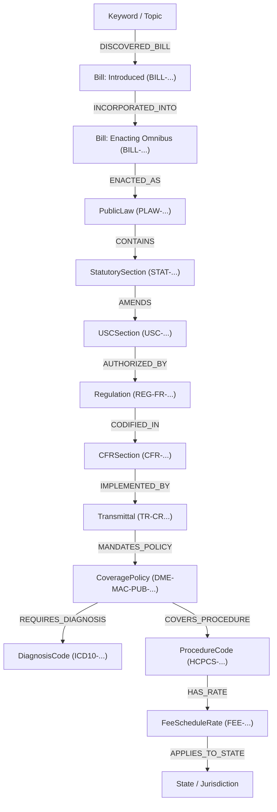

# Functional Specification: Agnostic Zero-Seed Policy Traversal & Knowledge Graph Reconstruction Engine

**Document ID:** `functional_specification_014.md`  
**Status:** Requirements Specification  
**Implementation Guidance:** Strictly Prohibited (DO NOT CODE YET)  
**Taxonomy Reference:** [LANGUAGE.md](file:///Users/diesel/Desktop/LAG/LANGUAGE.md)  
**Historical References:** [functional_specification_011.md](file:///Users/diesel/Desktop/LAG/functional_specification_011.md), [functional_specification_012.md](file:///Users/diesel/Desktop/LAG/functional_specification_012.md), [functional_specification_013.md](file:///Users/diesel/Desktop/LAG/functional_specification_013.md), [dataflow.md](file:///Users/diesel/Desktop/LAG/dataflow.md)  

---

## 1. System Objective

This specification defines the functional requirements for an **Agnostic, Zero-Seed Policy Traversal & Knowledge Graph Reconstruction Engine**. 

Given exclusively a single runtime `{Policy Keyword}` string (e.g., `"LTA"`), the engine autonomously and deterministically traverses official United States government publication systems (Congress.gov API, GovInfo GPO USLM XML, Federal Register API, CMS Transmittals, CMS Coverage Guidance, Alpha-Numeric HCPCS tables, and CMS DMEPOS Fee Schedules) to construct an unbroken, verifiable knowledge graph spanning from legislative initiative to geographic reimbursement rates.

The engine operates under the following functional mandates:
- **Zero-Seed Foreign Key Chaining:** The runtime `{Policy Keyword}` serves as the sole human input. Every downstream entity, publication record, regulatory directive, procedure code, and payment amount must be programmatically discovered, parsed, and handed off through strictly typed data contracts.
- **Agnostic Document & API Traversal:** All extraction behavior must operate on generic structural rules (dynamic search queries, semantic heading token matches in USLM XML trees, regulatory notice supersession parsing, semantic table header isolation in administrative publications, and key-based filtering on master coding tables). The engine must execute uniformly across arbitrary policy queries without hardcoded identifier constants, mock file redirects, or static lookup dictionaries.
- **Strict Fail-Fast Architecture:** The traversal pipeline enforces explicit, fatal exceptions immediately upon encountering an unresolvable record, malformed document, empty search response, or broken cross-agency link. The engine strictly forbids synthetic defaults, arbitrary fallbacks, or silent error suppressions.

---

## 2. End-to-End Agnostic Traversal Routing Specifications

### Hop 0: Policy Keyword $\to$ Legislative Initiative
* **Mechanism:** Dynamic Search / Discovery Hop.
* **Authoritative Source:** Congress.gov API v3 (`GET /v3/bill?query={Policy Keyword}&sort=relevancy`).
* **Input Contract:** Runtime string `{Policy Keyword}` (e.g., `"LTA"` or `"Lymphedema Treatment Act"`).
* **Agnostic Extraction Rules:**
  - Query the search endpoint dynamically without pre-filtering on hardcoded strings.
  - Score results against `{Policy Keyword}` tokens across `bills[*].title`, `bills[*].shortTitle`, and policy areas.
  - Select the primary advocacy bill entity.
* **Generated Output:** `Target_Bill_ID` (`composite: BILL-{congress}-{type}-{number}`).
* **Fail-Fast Boundary:** Raise `LegislativeResolutionError` if the query returns 0 items, fails authentication, or yields no candidate bill.

### Hop 1: Legislative Initiative $\to$ Enacted Public Law
* **Mechanism:** Hybrid Lineage Traversal (Direct Foreign Key OR Related-Bills Traversal).
* **Authoritative Source:** Congress.gov API v3 (`GET /v3/bill/{congress}/{type}/{number}` and `.../relatedbills`).
* **Input Contract:** `Target_Bill_ID`.
* **Agnostic Extraction Rules:**
  1. Inspect `bill.laws` array in primary bill response:
     - If populated $\to$ extract `laws[0].number` and `laws[0].type`. Set `enacting_bill_id = introduced_bill_id`.
  2. If `bill.laws` is empty:
     - Query `.../relatedbills`.
     - Inspect `relatedBills[*]` for relationships matching `"Included in omnibus"` or `"Identical bill"`.
     - Query the identified omnibus bill vehicle.
     - Extract `laws[0].number` and enactment date from the omnibus vehicle. Set `enacting_bill_id` to the omnibus vehicle.
* **Generated Output (`LegislativeHandoff`):**
  - `policy_keyword`: string
  - `introduced_bill_id`: string
  - `enacting_bill_id`: string
  - `public_law_id`: string (`composite: PLAW-{congress}-{law_number}`)
  - `congress`: integer
  - `enacted_date`: string
* **Fail-Fast Boundary:** Raise `EnactedLawNotFoundError` if neither the primary bill nor any related bills link to an official Public Law.

### Hop 2: Public Law $\to$ Codified Statutory Authority
* **Mechanism:** Direct Linkage + Structural XML Traversal.
* **Authoritative Source:** GovInfo GPO Bulk Data Repository (`PLAW-{congress}publ{law_number}.xml`).
* **Input Contract:** `LegislativeHandoff.public_law_id`.
* **Agnostic Extraction Rules:**
  - Derive GovInfo package identifier dynamically from `public_law_id` (`PLAW-{congress}publ{law_number}`).
  - Ingest the official USLM XML document.
  - Dynamically traverse all `<section>` elements:
    - Match `<heading>` and `<chapeau>` text against semantic tokens derived from the policy keyword and bill title.
    - Extract the matching legislative section number (`<num>`).
  - Within the matched section DOM tree, extract all codified statutory reference nodes:
    - Parse `<ref @href>` matching `/us/usc/...` combined with adjacent `<quotedContent>` subsection designators.
    - Extract statutory effective date from `<date>` elements.
* **Generated Output (`StatutoryHandoff`):**
  - `public_law_id`: string
  - `uslm_section_path`: string
  - `statute_section_number`: string
  - `statute_heading`: string
  - `amended_usc_citations`: array of strings (`["42 U.S.C. ..."]`)
  - `effective_date`: string
* **Fail-Fast Boundary:** Raise `StatutorySectionNotFoundError` if the XML package cannot be resolved, no section heading matches policy scope, or zero amended USC citations are extracted.

### Hop 3: Statutory Authority $\to$ Regulatory Final Rule
* **Mechanism:** Search / Discovery Hop.
* **Authoritative Source:** Federal Register Search API v1 (`GET /api/v1/documents.json`).
* **Input Contract:** `StatutoryHandoff.amended_usc_citations` and `statute_section_number`.
* **Agnostic Extraction Rules:**
  - Query documents filtering on `conditions[type][]=RULE` and `conditions[agencies][]=centers-for-medicare-medicaid-services`.
  - Search terms populated from `StatutoryHandoff` (`amended_usc_citations[0]` or `statute_section_number`).
  - Retrieve document detail for the top-ranking Final Rule.
  - Extract document metadata:
    - `document_number` $\to$ `fr_document_number`
    - `citation` $\to$ `fr_citation`
    - `docket_ids[0]` $\to$ `docket_id`
    - `regulation_id_numbers[0]` $\to$ `rin`
    - `cfr_references` array $\to$ deduplicated list of CFR titles, parts, and subparts
    - `effective_on` $\to$ `effective_date`
* **Generated Output (`RegulatoryHandoff`):**
  - `fr_document_number`: string
  - `fr_citation`: string
  - `docket_id`: string
  - `rin`: string
  - `cfr_references`: array of strings
  - `effective_date`: string
* **Fail-Fast Boundary:** Raise `RegulatoryRuleResolutionError` if 0 Final Rules match the statutory authority parameters or if mandatory metadata fields are missing.

### Hop 4: Regulatory Rule $\to$ Operational Claims Directive (CR & Transmittal)
* **Mechanism:** Search / Discovery Hop & Supersession Resolution.
* **Authoritative Source:** CMS Transmittals Repository & Claims Processing Manual Index.
* **Input Contract:** `RegulatoryHandoff.docket_id`, `StatutoryHandoff.statute_section_number`.
* **Agnostic Extraction Rules:**
  - Query CMS Transmittals index filtering on manual publications implementing the target statute or docket.
  - Parse transmittal metadata table (`CR Number`, `Transmittal Number`, `Subject`).
  - Ingest directive text and resolve rescission/supersession notices:
    - If directive states `"Transmittal X... is being rescinded and replaced by Transmittal Y"`, mark Transmittal X as superseded and designate Transmittal Y as active.
  - Extract operational billing classification flags from the active directive policy text:
    - Benefit Category Code (e.g., regex pattern matching `benefit category.*indicator for.*: ([A-Z0-9]+)`)
    - Pricing Indicator Code (e.g., regex pattern matching `pricing indicator of ['"]([0-9]+)['"]`)
    - BETOS Code (e.g., regex pattern matching `BETOS.*Code of ['"]([A-Z0-9]+)['"]`)
* **Generated Output (`OperationalHandoff`):**
  - `change_request_number`: string
  - `active_transmittal_number`: string
  - `superseded_transmittal_numbers`: array of strings
  - `cms_manual_publication`: string
  - `benefit_category_code`: string
  - `pricing_indicator_code`: string
  - `betos_code`: string
  - `effective_date`: string
* **Fail-Fast Boundary:** Raise `OperationalDirectiveMissingError` if no active transmittal or CR can be resolved, or if operational filter codes cannot be extracted.

### Hop 5: Operational Directive $\to$ Clinical Coverage Guidance
* **Mechanism:** Alternative Source Discovery (Primary Registry $\to$ Secondary Publisher Routing).
* **Authoritative Source:** 
  1. *Primary:* CMS Medicare Coverage Database (MCD) Search API.
  2. *Secondary:* Governing Joint DME MAC Administrative Publications Portal.
* **Input Contract:** `OperationalHandoff.change_request_number` and `OperationalHandoff.benefit_category_code`.
* **Agnostic Extraction Rules:**
  1. Query CMS MCD for NCD/LCD or Article matching the Change Request or policy keyword.
  2. If MCD returns HTTP 404 or empty results:
     - Follow contractor directives referenced in the active Transmittal text to route to the Joint DME MAC Administrative Publication Portal.
     - Search administrative correct coding and billing articles matching the operational benefit category.
     - Ingest the official publication HTML.
     - Agnostically parse the medical necessity section/table:
       - Locate table or list following heading matching `ICD-10-CM Codes that Support Medical Necessity` (or equivalent clinical indications header).
       - Extract all alphanumeric ICD-10 diagnosis codes.
     - Extract documented clinical prerequisites and frequency limitations.
* **Generated Output (`CoverageHandoff`):**
  - `coverage_guidance_id`: string
  - `publisher_type`: string (`"CMS_MCD"` or `"DME_MAC_JOINT_PUBLICATION"`)
  - `publication_title`: string
  - `qualifying_icd10_codes`: array of strings
  - `clinical_prerequisites`: array of strings
* **Fail-Fast Boundary:** Raise `ClinicalCoverageMissingError` if both primary MCD and secondary contractor portals fail to resolve coverage criteria or yield zero qualifying diagnosis codes.

### Hop 6: Operational Directive & Guidance $\to$ Standardized Procedure Codes
* **Mechanism:** Direct Linkage via Operational Key Filtering.
* **Authoritative Source:** CMS Alpha-Numeric HCPCS Dataset & CR Directive Attachment.
* **Input Contract:** `OperationalHandoff` (`benefit_category_code`, `pricing_indicator_code`, `betos_code`).
* **Agnostic Extraction Rules:**
  - Ingest the official CMS Level II Alpha-Numeric HCPCS dataset.
  - Filter procedure records **strictly by operational keys** without keyword filtering:
    - Match `Category_Code == OperationalHandoff.benefit_category_code` OR (`BETOS == OperationalHandoff.betos_code` AND `Pricing_Indicator == OperationalHandoff.pricing_indicator_code`).
  - Extract for each matching code:
    - Procedure code alphanumeric identifier
    - Long and short descriptors
    - Classification: Standard versus Custom / Not Otherwise Specified (NOS)
* **Generated Output (`CodingHandoff`):**
  - `benefit_category_code`: string
  - `betos_code`: string
  - `hcpcs_codes`: array of strings (complete matching code set)
  - `code_descriptions`: dictionary mapping code $\to$ description
  - `code_pricing_indicators`: dictionary mapping code $\to$ pricing indicator
  - `pricing_methodologies`: dictionary mapping code $\to$ `"NATIONAL_FEE_SCHEDULE"` or `"LOCAL_CONTRACTOR_PRICING"`
* **Fail-Fast Boundary:** Raise `CodingTableMismatchError` if 0 procedure codes qualify under the operational filters or if extracted codes violate HCPCS Level II syntax.

### Hop 7: Procedure Codes $\to$ Geographic Fee Schedule Matrix
* **Mechanism:** Direct Linkage via Matrix Unpivoting.
* **Authoritative Source:** CMS DMEPOS Fee Schedule Public Data Release.
* **Input Contract:** `CodingHandoff` and `OperationalHandoff.benefit_category_code`.
* **Agnostic Extraction Rules:**
  - Ingest the national DMEPOS Fee Schedule record set.
  - Filter rows where `Category == OperationalHandoff.benefit_category_code`.
  - Dynamically unpivot jurisdiction columns across all 54 states, territories, and districts:
    - Iterate across state header columns.
    - Extract reimbursement rate amounts for rural (`R`) and non-rural (`NR`) designations.
  - Reconcile codes present in `CodingHandoff` that lack national numeric fee schedule rates:
    - Classify unpriced custom/NOS codes under `LOCAL_CONTRACTOR_PRICING` as mandated by the operational directive.
    - Do NOT populate synthetic `$0.00` rates or discard unpriced codes.
* **Generated Output (`ReimbursementHandoff`):**
  - `fee_schedule_release`: string
  - `jurisdiction_count`: integer (`54`)
  - `records`: array of `FeeScheduleRecord` objects:
    - `hcpcs_code`: string
    - `jurisdiction_postal_code`: string
    - `rural_designation`: string (`"NR"` or `"R"`)
    - `rate_usd`: optional float (`None` for local contractor pricing)
    - `pricing_methodology`: string (`"NATIONAL_FEE_SCHEDULE"` or `"LOCAL_CONTRACTOR_PRICING"`)
  - `unpriced_custom_codes`: array of strings
* **Fail-Fast Boundary:** Raise `FeeScheduleIngestionError` if fee schedule records cannot be unpivoted across all 54 jurisdictions or if any code from `CodingHandoff` is omitted from the reconciliation.

---

## 3. Knowledge Graph Invariant and Topology Requirements

The generated knowledge graph must instantiate the following discrete entity nodes and directed relationship edges dynamically:

### Invariant Rules
1. **Unbroken Lineage:** No disconnected subgraphs or dangling entity nodes are permitted.
2. **True Legislative Edge:** If `introduced_bill_id != enacting_bill_id`, the introduced bill must connect via `[:INCORPORATED_INTO]` to the omnibus bill, which connects via `[:ENACTED_AS]` to the Public Law. A direct shortcut edge from the introduced bill to the Public Law is strictly forbidden.
3. **Rescission Tracking:** Rescinded transmittals must be linked to active transmittals via `[:SUPERSEDES]` or captured explicitly in `superseded_transmittal_numbers`.
4. **Complete Geographic Coverage:** Every priced HCPCS code must be represented across all 54 jurisdictions for both rural and non-rural payment amounts.

---

## 4. Strict Fail-Fast Exception Hierarchy

The engine must enforce strict fail-fast error handling by raising explicit, typed exceptions derived from a base `PolicyTraversalError`:

1. `LegislativeResolutionError`: Hop 0 failure (0 search hits or Congress.gov API failure).
2. `EnactedLawNotFoundError`: Hop 1 failure (un-enacted bill with no omnibus link).
3. `StatutorySectionNotFoundError`: Hop 2 failure (USLM XML missing or unparseable).
4. `RegulatoryRuleResolutionError`: Hop 3 failure (no matching CMS Final Rule).
5. `OperationalDirectiveMissingError`: Hop 4 failure (CR or active Transmittal missing).
6. `ClinicalCoverageMissingError`: Hop 5 failure (no coverage guidance or diagnoses resolved).
7. `CodingTableMismatchError`: Hop 6 failure (no HCPCS codes match operational filters).
8. `FeeScheduleIngestionError`: Hop 7 failure (unpivoting failure or unmapped codes).

---

## 5. Acceptance Criteria

The system implementation will be considered complete and `{sufficient}` when:

1. **Zero Hardcoded Lookups:** Execution from `{Policy Keyword}` to the final fee schedule matrix executes purely through dynamic API calls, structural DOM/XML traversals, and table filters without reading static mock files or hardcoded ID dictionaries.
2. **Agnostic Extraction:** The parsing logic applies universally to any healthcare or legislative policy topic conforming to these publication structures without case-by-case branching.
3. **Total Graph Integrity:** The knowledge graph contains 100% verifiable nodes tracing directly to official government records with zero placeholder rates or hallucinated keys.
4. **Immediate Fail-Fast:** Any broken hop immediately triggers its specific fatal exception, halting pipeline execution and preventing corrupted graph states.

