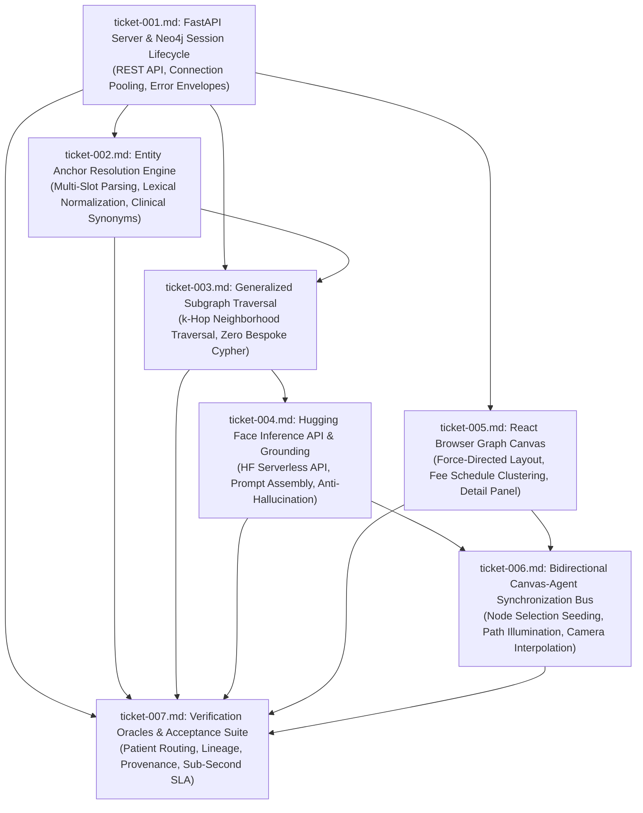

# Wayfinder Architectural Map: Browser-Based React Graph Visualization & Hugging Face GraphRAG Architecture

**Governing File:** `functional_specification_004.md`  
**Run ID:** `20261013T025302-800-gxuw`  
**Planning Status:** Resolved & Planned  
**Taxonomy Reference:** `LANGUAGE.md`

---

## 1. Destination

Deconstruct, plan, and lock all architectural decisions, external API contracts, database query templates, component interfaces, and verification suites required to implement [`functional_specification_004.md`](file:///Users/diesel/Desktop/LAG/functional_specification_004.md).

The planned system delivers three synchronized operational capabilities:
1. **Interactive Graph Visualization Interface:** A high-performance web-browser canvas rendering 14 node entity types and 14 relationship types across federal legislative, statutory, regulatory, operational coding, and fee schedule tiers, with persistent visual discrimination, force-directed stabilization, high-cardinality node clustering for 3,800+ `:FeeScheduleEntry` nodes, and a selection inspection drawer.
2. **Hugging Face GraphRAG Engine:** A generalized graph retrieval and conversational synthesis service that eliminates bespoke Cypher query programming and model Cypher hallucination by executing deterministic entity anchor linking, generalized topological subgraph expansion ($k=1$ to $3$ hops), structured Markdown factual assembly, and Hugging Face open-weight LLM synthesis with mandatory provenance citations (`INV-PROVENANCE-COMPLETENESS`).
3. **Bidirectional Canvas-Agent Synchronization:** Native event coupling where user canvas selections seed GraphRAG inquiries, and retrieved subgraphs dynamically illuminate on the canvas with 20% background attenuation and 350ms viewport camera framing.

---

## 2. Notes and System Conventions

- **Authoritative Taxonomy:** All evaluation criteria (`{errors}`, `{correctness}`, `{functionality}`, `{correct required outputs}`, `{sufficient}`, `{insufficient}`) strictly conform to [`LANGUAGE.md`](file:///Users/diesel/Desktop/LAG/LANGUAGE.md).
- **Core Invariant Mandates:**
  - `INV-UNBROKEN-ANCESTRY`: Zero tolerance for orphan nodes. Every rendered node connects to an authorizing root Policy node.
  - `INV-NO-KEYWORD-BRIDGING`: Direct procedure-to-diagnosis edges (`HCPCSCode -> ICD10Code`) are strictly prohibited; clinical eligibility is authorized through official CMS `CoveragePolicy` articles.
  - `INV-FAIL-FAST`: Unrecognized entities, invalid jurisdictions, ungrounded prompts, and external API faults raise structured fatal errors immediately without silent fallbacks.
  - `INV-PROVENANCE-COMPLETENESS`: All factual statements must cite edge provenance metadata (`source_uri`, `selector`, `ingestion_timestamp`, `run_id`).
  - `INV-50-STATE-COMPLETENESS`: Guarantees coverage across all 4 DME MAC Jurisdictions and 54 states/territories.

---

## 3. Decisions So Far (Decision Ticket Register)

| Ticket | Human-Readable Ticket Name | Scope / Tier | Status | Blocked By |
|---|---|---|---|---|
| [`ticket-001.md`](tickets/ticket-001.md) | Backend FastAPI Server Architecture, REST Routes, and Neo4j Session Lifecycle Specification | Backend Infrastructure | RESOLVED | None (Root) |
| [`ticket-002.md`](tickets/ticket-002.md) | Multi-Slot Entity Anchor Resolution and Clinical Synonym Normalization Specification | GraphRAG Stage 1: Anchor Linking | RESOLVED | `ticket-001.md` |
| [`ticket-003.md`](tickets/ticket-003.md) | Generalized Topological Subgraph Traversal and Multi-Hop Path Query Specification | GraphRAG Stage 2: Subgraph Expansion | RESOLVED | `ticket-001.md`, `ticket-002.md` |
| [`ticket-004.md`](tickets/ticket-004.md) | Hugging Face Inference API Integration, Operational Parameters, and Prompt Grounding Specification | GraphRAG Stages 3-5: LLM Synthesis | RESOLVED | `ticket-003.md` |
| [`ticket-005.md`](tickets/ticket-005.md) | React Browser Graph Canvas, Force-Directed Physics, and High-Density Node Throttling Specification | Frontend Visualization Canvas | RESOLVED | `ticket-001.md` |
| [`ticket-006.md`](tickets/ticket-006.md) | Bidirectional Canvas-Agent Synchronization Bus and Path Illumination Specification | Canvas-Agent Interaction Bus | RESOLVED | `ticket-004.md`, `ticket-005.md` |
| [`ticket-007.md`](tickets/ticket-007.md) | Verification Oracles, Acceptance Test Suite, and SLA Conformance Specification | Testing & System Verification | RESOLVED | `ticket-001.md` through `ticket-006.md` |

---

## 4. Dependency DAG

---

## 5. Not Yet Specified (Fog of War)

- Cross-policy comparative summarization spanning more than 5 distinct legislative domains simultaneously.
- Dynamic GPU WebGL instancing thresholds for graph topologies exceeding 25,000 active nodes.

---

## 6. Out of Scope

- Model Cypher generation or NL-to-Cypher translations (strictly rejected in favor of topological retrieval).
- Direct HCPCSCode-to-ICD10Code relationships (strictly prohibited by `INV-NO-KEYWORD-BRIDGING`).
- Commercial payer rule ingestion (Aetna, UnitedHealthcare, Cigna) prior to federal baseline stabilization.
