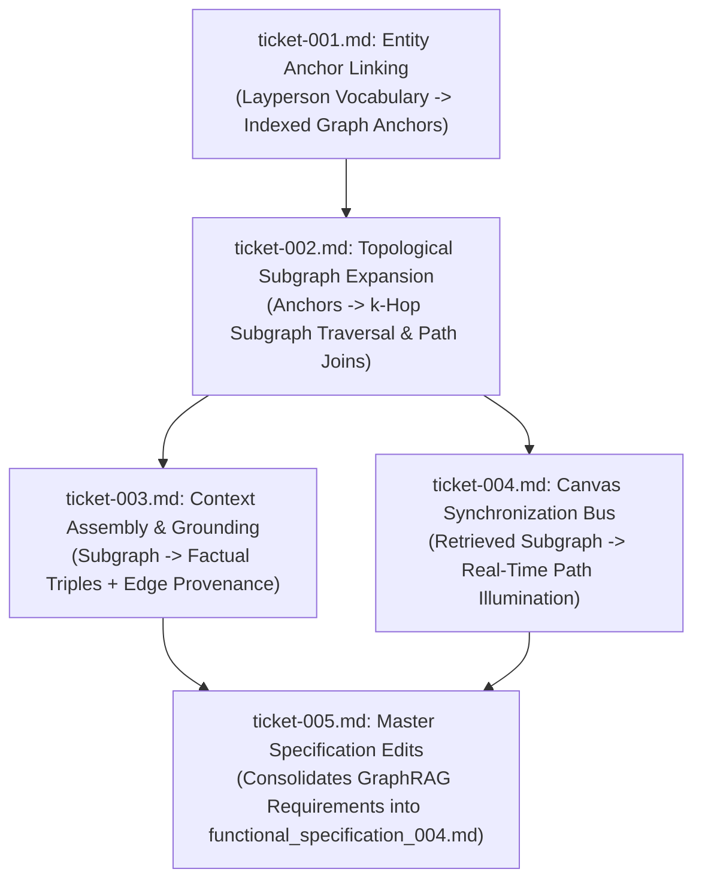

# Wayfinder Architectural Map: GraphRAG Specification for Browser Graph Visualizer

**Governing File:** `functional_specification_004.md`  
**Planning Status:** Active Frontier  
**Planning Mode:** Wayfinder Specification & Decision Mapping  
**Taxonomy Reference:** `LANGUAGE.md`

---

## 1. Destination

Formulate and document the precise functional requirements, contracts, and behavioral specifications needed to update [`functional_specification_004.md`](file:///Users/diesel/Desktop/LAG/functional_specification_004.md) from a brittle tool-calling/text-to-cypher interface into a high-performance, generalized **Graph-Augmented Retrieval Generation (GraphRAG)** architecture. 

The resulting specification must ensure:
1. **Zero Bespoke Query Coding:** Eliminates the unscalable requirement to write custom Cypher queries for every anticipated user question.
2. **Zero Cypher Syntax Hallucination:** Eliminates free-form Cypher generation by the model, preventing syntax errors and conversational self-correction latency loops.
3. **Sub-Second Real-World Patient Benefit Routing:** Deterministically maps real-world patient language (e.g., *"I am from Wisconsin, survived breast cancer, need lymphedema supplies, I'm on Medicare"*) to exact graph anchors, $k$-hop subgraphs, covered garment codes, regional claims contractors, and local fee schedule rates.
4. **Native Visual Canvas Synchronization:** The exact subgraph retrieved and fed to the LLM is simultaneously emitted to the React canvas to illuminate the traversed path in real time.

---

## 2. Notes and System Conventions

- **Authoritative Vocabulary:** All evaluation criteria (`{errors}`, `{correctness}`, `{functionality}`, `{correct required outputs}`, `{sufficient}`, `{insufficient}`) strictly adhere to [`LANGUAGE.md`](file:///Users/diesel/Desktop/LAG/LANGUAGE.md).
- **Core System Rules:**
  - `INV-UNBROKEN-ANCESTRY`: Zero tolerance for orphaned nodes. Every entity in the retrieved subgraph must connect via verified edges to an authorizing policy.
  - `INV-NO-KEYWORD-BRIDGING`: Prohibits direct procedure-to-diagnosis connections; all clinical indications must be legally mediated through an official `CoveragePolicy` article.
  - `INV-FAIL-FAST`: The system halts immediately with structured diagnostics if an entity is missing or ungrounded; synthetic defaults and probabilistic guesses are strictly forbidden.
  - `INV-PROVENANCE-COMPLETENESS`: Every factual statement generated by the model must cite edge provenance metadata (`source_uri`, `selector`, `ingestion_timestamp`, `run_id`).
- **No Implementation Guidance (`craft-documentation` constraint):** All documentation must describe *what* the system does, its behavioral contracts, inputs, outputs, constraints, and acceptance criteria, strictly omitting library installation commands, component code sketches, or build instructions.

---

## 3. Decisions So Far (Decision Ticket Register)

| Ticket | Human-Readable Ticket Name | Scope / Tier | Status | Blocked By |
|---|---|---|---|---|
| [`ticket-001.md`](tickets/ticket-001.md) | Entity Anchor Linking and Layperson Vocabulary Normalization Specification | Input Entity Resolution | RESOLVED | None (Root) |
| [`ticket-002.md`](tickets/ticket-002.md) | Generalized Topological Subgraph Expansion and Neighborhood Traversal Specification | Graph Topology Retrieval | RESOLVED | `ticket-001.md` |
| [`ticket-003.md`](tickets/ticket-003.md) | Factual Context Assembly, Edge Provenance Formatting, and Prompt Grounding Specification | Context Synthesis & Grounding | RESOLVED | `ticket-002.md` |
| [`ticket-004.md`](tickets/ticket-004.md) | Bidirectional Visual Canvas Synchronization and Active Subgraph Illumination Specification | Canvas-Agent Interaction Bus | RESOLVED | `ticket-002.md` |
| [`ticket-005.md`](tickets/ticket-005.md) | Master Specification Synthesis and Edits for `functional_specification_004.md` | Specification Compilation | RESOLVED | `ticket-001.md` through `ticket-004.md` |

---

## 4. Dependency DAG

---

## 5. Not Yet Specified (Fog of War)

- Community summarization metrics for cross-policy comparisons beyond 5 concurrent policy keywords.
- Dynamic clustering thresholds for graph topologies exceeding 10,000 active nodes.

---

## 6. Out of Scope

- Bespoke Cypher generation functions for ad-hoc user questions.
- Unconstrained free-form Cypher generation by open-weight models.
- Commercial payer rule ingestion (Aetna, UnitedHealthcare, Cigna) prior to federal baseline stabilization.
