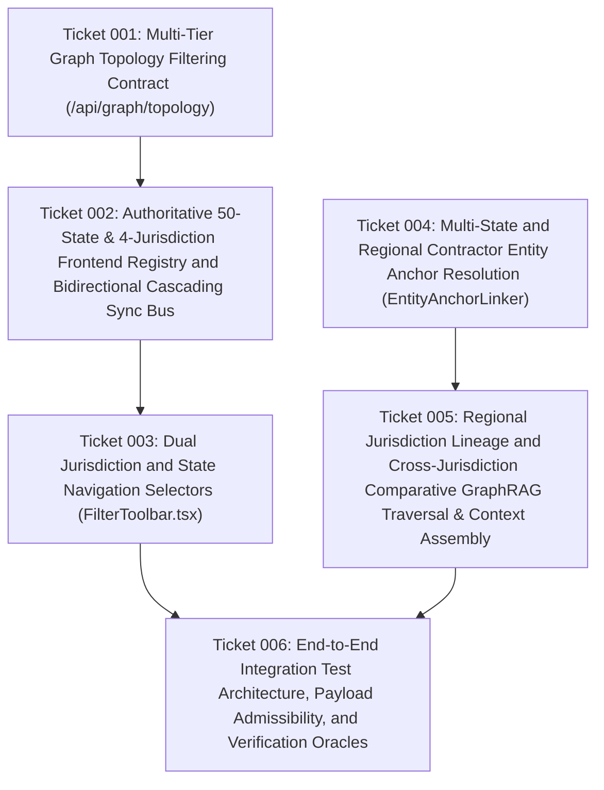

# Wayfinder Roadmap: Dual Jurisdiction and State Governance Architecture (`20261013T185957-734-5ytd`)

## 1. Destination

Full, independent, and bidirectionally synchronized support for **both** the 4 CMS DME MAC Regional Jurisdictions (`JURIS-DME-A`, `JURIS-DME-B`, `JURIS-DME-C`, `JURIS-DME-D`) and all 50 US States (+ DC, PR, VI) across:
1. **Top Navigation Toolbar (`src/frontend/src/components/FilterToolbar.tsx`):** Two distinct, clearly labeled selectors (`JURISDICTION:` and `STATE:`) with dynamic cascading and automatic parent-contractor synchronization.
2. **Bidirectional Canvas-Agent Sync Bus (`src/frontend/src/context/GraphSyncContext.tsx` & `src/frontend/src/App.tsx`):** Complete CMS DME MAC jurisdiction-to-state registry, cascading state options, regional node/edge illumination (`JURIS-DME-*` and `COVERS_STATE`), and 60 FPS National Overview default.
3. **Multi-Tier Topology API (`src/api/routes.py`):** `GET /api/graph/topology` accepting both `jurisdiction_filter` and `state_filter` independently and in combination, returning regional contractor subgraphs with collapsed fees on jurisdiction filter, state-specific non-rural fee schedules on state filter, and the complete macro graph on National Overview.
4. **GraphRAG Retrieval Pipeline (`src/graphrag/entity_linker.py`, `src/graphrag/traversal.py`, `src/graphrag/context_assembler.py`, `src/graphrag/pipeline.py`, `src/graphrag/models.py`):** Multi-state anchor extraction, regional contractor lexical linking, dedicated jurisdiction lineage traversal, cross-jurisdiction comparative state+HCPCS traversal, and multi-state fee context assembly.

---

## 2. Notes & Architectural Context

- **Governing Specification:** [`functional_specification_008.md`](file:///Users/diesel/Desktop/LAG/.sandcastle/worktrees/agent-plan-20261013T185957-734-5ytd/functional_specification_008.md)
- **Taxonomy Reference:** [`LANGUAGE.md`](file:///Users/diesel/Desktop/LAG/.sandcastle/worktrees/agent-plan-20261013T185957-734-5ytd/LANGUAGE.md)
- **Live Neo4j Ground Truth Verified:**
  - 4 `Jurisdiction` nodes (`JURIS-DME-A`, `JURIS-DME-B`, `JURIS-DME-C`, `JURIS-DME-D`) connected via `APPLIES_TO_JURISDICTION` from `CMS-CR-13286` (LTA) and `CMS-CR-13217` (IVIG).
  - 53 `State` nodes (50 US states + DC + PR + VI) connected via `COVERS_STATE` from their legally assigned `Jurisdiction` node (`JURIS-DME-A`: 12, `JURIS-DME-B`: 7, `JURIS-DME-C`: 17, `JURIS-DME-D`: 17).
  - 71 non-rural `FeeScheduleEntry` nodes per state (70 LTA + 1 IVIG) connected via `(h:HCPCSCode)-[:HAS_FEE_SCHEDULE]->(f:FeeScheduleEntry)-[:APPLIES_TO]->(s:State)`.

---

## 3. Dependency DAG

---

## 4. Decisions So Far (Resolved Tickets)

1. **[Ticket 001: Multi-Tier Graph Topology Filtering Contract (`/api/graph/topology`)](file:///Users/diesel/Desktop/LAG/.sandcastle/worktrees/agent-plan-20261013T185957-734-5ytd/wayfinder/20261013T185957-734-5ytd/tickets/ticket-001.md)** — `RESOLVED`
   - Locked `jurisdiction_filter` and `state_filter` query parameters on `GET /api/graph/topology` in `src/api/routes.py`, supporting National Overview (`155` non-fee nodes), Jurisdiction-Level filtering (single `Jurisdiction` + its `COVERS_STATE` states, fees collapsed by default), State-Level filtering (single `State` + parent `Jurisdiction` + 71 non-rural `FeeScheduleEntry` nodes = `171` nodes), and fail-fast HTTP 400 validation on invalid codes.
2. **[Ticket 002: Authoritative 50-State & 4-Jurisdiction Frontend Registry and Bidirectional Cascading Sync Bus](file:///Users/diesel/Desktop/LAG/.sandcastle/worktrees/agent-plan-20261013T185957-734-5ytd/wayfinder/20261013T185957-734-5ytd/tickets/ticket-002.md)** — `RESOLVED`
   - Locked `DME_JURISDICTIONS`, `STATE_TO_JURISDICTION`, and `ALL_STATES_SORTED` in `src/frontend/src/context/GraphSyncContext.tsx`, bidirectional cascading between `filterJurisdiction` and `filterState`, automatic parent contractor reflection when any state is chosen, dynamic state option scoping when a jurisdiction is chosen, and regional subgraph illumination on the canvas.
3. **[Ticket 003: Dual Jurisdiction and State Navigation Selectors (`FilterToolbar.tsx`)](file:///Users/diesel/Desktop/LAG/.sandcastle/worktrees/agent-plan-20261013T185957-734-5ytd/wayfinder/20261013T185957-734-5ytd/tickets/ticket-003.md)** — `RESOLVED`
   - Locked the two separate dropdown controls (`JURISDICTION:` and `STATE:`) in `src/frontend/src/components/FilterToolbar.tsx` with exact option labels from Requirement 5.1.1 and Requirement 5.1.2.
4. **[Ticket 004: Multi-State and Regional Contractor Entity Anchor Resolution (`EntityAnchorLinker`)](file:///Users/diesel/Desktop/LAG/.sandcastle/worktrees/agent-plan-20261013T185957-734-5ytd/wayfinder/20261013T185957-734-5ytd/tickets/ticket-004.md)** — `RESOLVED`
   - Locked `_extract_state_anchors` in `src/graphrag/entity_linker.py` to extract all states in comparative queries (e.g., `STATE-CA` and `STATE-NY`), enhanced `_extract_jurisdiction_anchors` to resolve explicit `Jurisdiction A/B/C/D` and multi-region contractor names (`CGS` -> `JURIS-DME-B`, `JURIS-DME-C`; `Noridian` -> `JURIS-DME-A`, `JURIS-DME-D`), and refined `GEO_LOCATION_INDICATORS` fail-fast boundaries.
5. **[Ticket 005: Regional Jurisdiction Lineage and Cross-Jurisdiction Comparative GraphRAG Traversal & Context Assembly](file:///Users/diesel/Desktop/LAG/.sandcastle/worktrees/agent-plan-20261013T185957-734-5ytd/wayfinder/20261013T185957-734-5ytd/tickets/ticket-005.md)** — `RESOLVED`
   - Locked `_execute_jurisdiction_traversal` and multi-state comparative traversal in `src/graphrag/traversal.py`, `COVERS_STATE` regional state listing and multi-state `A6522` fee reporting in `src/graphrag/context_assembler.py`, and `state_code` handling in `src/graphrag/pipeline.py`.
6. **[Ticket 006: End-to-End Integration Test Architecture, Payload Admissibility, and Verification Oracles for Dual Jurisdiction and State Governance](file:///Users/diesel/Desktop/LAG/.sandcastle/worktrees/agent-plan-20261013T185957-734-5ytd/wayfinder/20261013T185957-734-5ytd/tickets/ticket-006.md)** — `RESOLVED`
   - Locked zero-mock payload admissibility rules (`INV-PAYLOAD-01`), schema-grounded verification oracles (`INV-ASSERTION-01`), and the [Authoritative Integration Test Matrix](file:///Users/diesel/Desktop/LAG/.sandcastle/worktrees/agent-plan-20261013T185957-734-5ytd/wayfinder/20261013T185957-734-5ytd/test_matrix.md) across all 9 modified components and all 6 Acceptance Criteria of `functional_specification_008.md`.

---

## 5. Open Frontier

- None. All feature architecture tickets (`ticket-001` through `ticket-005`) and integration test planning tickets (`ticket-006`) are resolved and documented in the [Master Component-to-Edit Matrix](file:///Users/diesel/Desktop/LAG/.sandcastle/worktrees/agent-plan-20261013T185957-734-5ytd/wayfinder/20261013T185957-734-5ytd/master_edit_matrix.md) and [Authoritative Integration Test Matrix](file:///Users/diesel/Desktop/LAG/.sandcastle/worktrees/agent-plan-20261013T185957-734-5ytd/wayfinder/20261013T185957-734-5ytd/test_matrix.md).

---

## 6. Not Yet Specified (Fog)

- None. Zero ambiguity remains across component schemas, admissible payloads, or verification oracles (`{sufficient}`).

---

## 7. Out of Scope

- Mutating the underlying Tier 1–5 ingestion pipeline or altering the 3,971-node Neo4j database snapshot.
- Adding synthetic or ungrounded fee schedule records or mock test fixtures.
- Writing executable test code prior to explicit operator authorization (`INV-BOUNDARY-01`).
