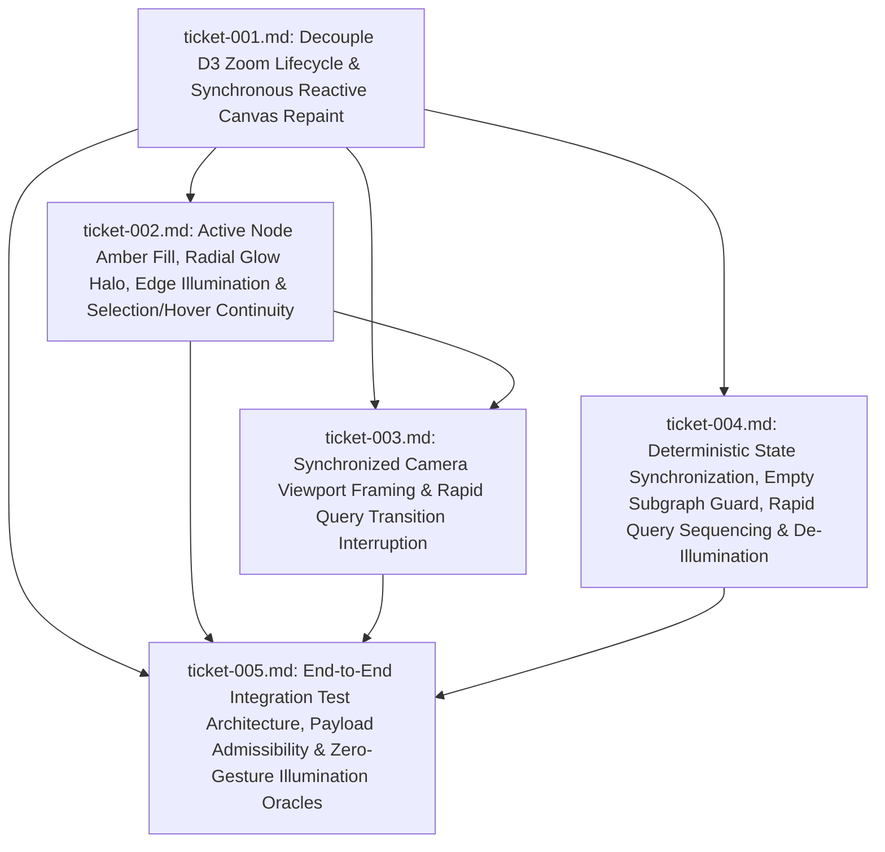

# Wayfinder Roadmap: Immediate Synchronous Visualizer Illumination (`20261013T194318-162-mbmi`)

## Destination

Eliminate latent HTML5 canvas repainting and achieve immediate, zero-gesture visual synchronization between the GraphRAG query lifecycle (`GraphSyncContext`, `AgentChatDrawer`, `NodeDetailDrawer`, `FilterToolbar`) and the force-directed blueprint canvas (`GraphCanvas`), fulfilling all requirements and acceptance criteria in `functional_specification_009.md`.

---

## Notes

- **Authoritative Seed Specification:** `functional_specification_009.md`
- **Primary Architectural Root Cause Identified:**
  1. In `src/frontend/src/components/GraphCanvas.tsx`, the `useEffect` initializing `d3.zoom` (`lines 358–380`) previously depended on `[render]` and bound `.on('zoom', ...)` directly to a captured `render` closure, while the camera framing `useEffect` (`lines 77–81`) was declared *above* both `renderRef` assignment (`lines 314–316`) and `d3.zoom` initialization (`lines 358–380`).
  2. Consequently, whenever `isIlluminated` and `activeNodePKs` transitioned to active state, `frameActiveSubgraph` invoked `.call(zoomBehaviorRef.current.transform, targetTransform)` on the *previous* `d3.zoom` instance whose `'zoom'` handler closed over the *stale* pre-illumination `render` callback (`isIlluminated = false`, `activeNodePKs = Set(0)`). Every animation frame of the 350ms camera transition repainted the canvas using that stale closure, leaving the canvas dark until a manual mouse event triggered the newly bound `d3.zoom` instance.
  3. Furthermore, `GraphCanvas.tsx` rendered active nodes using `visual.badgeColor` rather than `#ffb703` (`CANVAS_PALETTE.accentAmber`) with `rgba(255, 183, 3, 0.45)` radial glow halos, did not gate `isActive` / `isActiveEdge` on `isIlluminated`, and declared `frameActiveSubgraph` before `d3.forceSimulation` initialized node `(x, y)` coordinates.
  4. In `src/frontend/src/context/GraphSyncContext.tsx` and `src/frontend/src/components/AgentChatDrawer.tsx`, empty subgraph responses (`active_node_pks: []`) set `isIlluminated = true`, rapid successive queries were blocked by `isQueryLoading`, and closing the chat inquiry drawer did not invoke `clearIllumination()`.

---

## Ticket Dependency Graph (DAG)

---

## Decisions So Far

1. **[ticket-001.md](tickets/ticket-001.md) — Decouple D3 Zoom Lifecycle from Render Callback and Enforce Synchronous Reactive Canvas Repaint (Resolved):**
   - Synchronously assign `renderRef.current = render;` in `GraphCanvas` component body so `renderRef.current` is never stale.
   - Initialize `d3.zoom` once on mount (`useEffect(..., [])`) and delegate its `'zoom'` listener to `renderRef.current()`.
   - Add a dedicated reactive redraw `useEffect` (`[render, isIlluminated, activeNodePKs, activeEdgeKeys, selectedNode, hoveredNode]`) that invokes `render()` synchronously and schedules a `requestAnimationFrame(() => renderRef.current())` repaint, ensuring immediate updates even when the D3 simulation has settled (`alpha < alphaMin`).
   - Synchronize canvas buffer dimensions non-destructively inside `render()`, `window` `'resize'`, and `ResizeObserver` callbacks.

2. **[ticket-002.md](tickets/ticket-002.md) — Active Node Amber Fill, Radial Glow Halo, Directional Edge Illumination, and Selection/Hover Continuity (Resolved):**
   - Gate `isActive` and `isActiveEdge` strictly on `isIlluminated`, resolving link endpoints safely across both `GraphNode` objects and string PKs via a `nodeByPk` map.
   - Render active nodes (`isActive`) immediately in gold/amber (`#ffb703` / `CANVAS_PALETTE.accentAmber`) with outer radial glow halos (`rgba(255, 183, 3, 0.45)`) and inner active halo rings (`#f59e0b` / `CANVAS_PALETTE.activeHalo`), elevated leader badge contrast, and active amber typography.
   - Preserve full opacity (`alpha = 1.0`), distinctive outer selection ring for `selectedNode`, accurate active-radius hit-testing, and a non-blocking floating tooltip for `hoveredNode`.

3. **[ticket-003.md](tickets/ticket-003.md) — Synchronized Camera Viewport Framing and Rapid Query Transition Interruption (Resolved):**
   - Order the `frameActiveSubgraph` `useEffect` after the `d3.forceSimulation` and `d3.zoom` initialization effects, and pre-tick the simulation (`simulation.tick(1)`) when initial node coordinates are undefined.
   - In `frameActiveSubgraph`, call `renderRef.current()` immediately at `t = 0ms`, call `selection.interrupt()` to cancel any in-flight transition, execute the 350ms `d3.easeCubicInOut` zoom transition, and bind `.on('end', () => renderRef.current())` for final frame stabilization.
   - Interrupt any active canvas transition and invoke `renderRef.current()` immediately when `isIlluminated` reverts to `false`.

4. **[ticket-004.md](tickets/ticket-004.md) — Deterministic State Synchronization, Empty Subgraph Guard, Rapid Query Sequencing, and Responsive De-Illumination (Resolved):**
   - In `GraphSyncContext.tsx`, guard `setIlluminatedPath` so empty `active_node_pks` responses (`length === 0`) immediately clear `activeNodePKs` and `activeEdgeKeys` and set `isIlluminated` to `false`.
   - Use a monotonic request counter (`latestQueryIdRef`) in `submitInquiry` and `clearIllumination` so rapid successive queries execute without being dropped by `isQueryLoading` and overwrite previous paths deterministically.
   - In `AgentChatDrawer.tsx`, invoke `clearIllumination()` when the user closes the chat inquiry drawer (`✕`), immediately reverting `isIlluminated` to `false` and repainting the canvas to baseline blueprint state.

5. **[ticket-005.md](tickets/ticket-005.md) — End-to-End Integration Test Architecture, Payload Admissibility Governance, and Zero-Gesture Canvas Illumination Verification Oracles (Resolved):**
   - Enforce `INV-PAYLOAD-01`: bind all integration test inputs exclusively to authentic codebase schemas (`GraphNode`, `GraphLink`, `NodeProperties`, `EdgeProvenance`, `AnchorEntity`, `GraphRAGQueryRequest`, `GraphRAGQueryResponse`, `TopologyResponse`) and authentic producer responses from `/api/graph/topology`, `/api/graphrag/query`, `/api/graphrag/subgraph`, and `DME_JURISDICTIONS` with zero synthetic mocks or backfilled optional fields.
   - Enforce `INV-ASSERTION-01` across five deterministic verification oracles (`IT-01` through `IT-05` in [`test-matrix.md`](test-matrix.md)): (1) zero-gesture immediate reactive redraw & amber/halo illumination in settled simulation state, (2) pre-ticked simulation coordinates & 350ms synchronized camera framing via `renderRef.current()`, (3) zero-gesture de-illumination across `AgentChatDrawer` close (`✕`) and `FilterToolbar` reset triggers, (4) preserved `selectedNode` outer selection ring and non-blocking `hoveredNode` inspection tooltip during illumination, and (5) rapid successive query sequencing (`latestQueryIdRef`), empty subgraph guard (`active_node_pks: []`), and resize continuity.

---

## Not Yet Specified Fog

- **None (Frontier Empty):** All feature implementation decisions (`ticket-001.md` through `ticket-004.md`) and integration test verification decisions (`ticket-005.md` and `test-matrix.md`) for `functional_specification_009.md` are resolved and certified `{sufficient}`.

---

## Out of Scope Boundaries

- Modifying backend Neo4j ingestion pipelines, Cypher traversal logic, or FastAPI route schemas (`src/api/`, `src/graph/`, `src/graphrag/`).
- Writing executable test code, test fixtures, parsers, or expected-output files during this `read-and-plan` session (`INV-BOUNDARY-01`).
