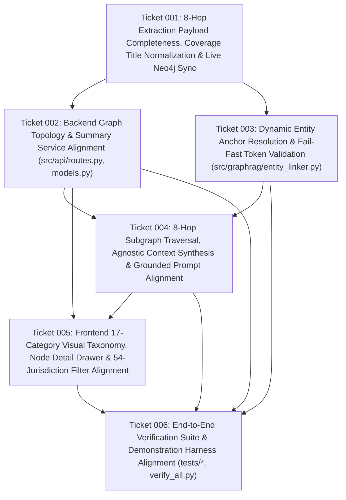

# Wayfinder Architectural Roadmap (`20261014T030858-722-708n`)

## 1. Upstream Functional Specification
- **Seed Specification:** `functional_specification_015.md` (*Functional Specification 015: End-to-End Agnostic Graph Persistence, Retrieval, and Visualization Alignment*)
- **System Objective:** Synchronize the live Neo4j graph database, backend retrieval and GraphRAG synthesis services, frontend visualization canvas and inspection drawer, and verification suites with the 8-hop zero-seed knowledge graph ontology (`17` entity labels, `18` relationship types, `54` US states/territories, `3,875` nodes, `7,593` edges), eliminating all hardcoded policy identifiers, static fallback text, unmapped entity categories, and obsolete shortcut relationships.

---

## 2. End-to-End Architecture & Dependency Topology

---

## 3. Decision Ticket Index

| Ticket ID | Path | Architectural Scope | Target Files |
| :--- | :--- | :--- | :--- |
| **Ticket 001** | `wayfinder/20261014T030858-722-708n/tickets/ticket-001.md` | Fix Hop 5 CPT license `<h1>` title collision in `tier4a_coverage.py`, fix Tier 5 nested `bill.cboCostEstimates` parsing in `tier5_context.py`, restore valid Senate LDA JSON asset in `Extraction/assets/tier5_lda_senate_filings_3630.json`, expand `Neo4jSyncEngine` to all 17 labels and 18 edge types with stale-node purge and idempotent synchronization, regenerate `exports/lta_knowledge_graph.json`, and synchronize live Neo4j (`3,875` nodes, `7,593` edges). | `src/graph/tier4a_coverage.py`, `src/graph/tier5_context.py`, `Extraction/assets/tier5_lda_senate_filings_3630.json`, `src/graph/neo4j_sync.py`, `exports/lta_knowledge_graph.json` |
| **Ticket 002** | `wayfinder/20261014T030858-722-708n/tickets/ticket-002.md` | Align `/api/graph/topology` and `/api/graph/summary` with `FeeScheduleRate`, `HAS_RATE`, and `APPLIES_TO_STATE`; derive human-readable `name` across all 17 entity labels from persisted properties; scope `Jurisdiction` and `State` nodes on state/jurisdiction filters (including `GU`); return HTTP 400 Bad Request on unrecognized state or jurisdiction codes. | `src/api/routes.py`, `src/api/models.py` |
| **Ticket 003** | `wayfinder/20261014T030858-722-708n/tickets/ticket-003.md` | Replace hardcoded bill/document/code regexes in `EntityAnchorLinker` with dynamic Neo4j catalog resolution across all 17 entity categories, all 18 primary key prefixes, and all 54 US states/territories (`GU` included); enforce fail-fast `EntityResolutionError` on invalid jurisdiction codes, nonexistent primary keys, or unresolved tokens. | `src/graphrag/entity_linker.py`, `src/api/routes.py` |
| **Ticket 004** | `wayfinder/20261014T030858-722-708n/tickets/ticket-004.md` | Rewrite Cypher traversal patterns in `TopologicalTraversalEngine` to follow the 8-hop relationship chain (`DISCOVERED_BILL` $\to$ `INCORPORATED_INTO` $\to$ `ENACTED_AS` $\to$ `CONTAINS` $\to$ `AMENDS` $\to$ `AUTHORIZED_BY` $\to$ `CODIFIED_IN` $\to$ `IMPLEMENTED_BY` $\to$ `MANDATES_POLICY` $\to$ `REQUIRES_DIAGNOSIS` / `COVERS_PROCEDURE` $\to$ `HAS_RATE` $\to$ `APPLIES_TO_STATE`); remove all static fallback strings in `GraphContextAssembler` and `HuggingFaceSynthesizer`. | `src/graphrag/traversal.py`, `src/graphrag/context_assembler.py`, `src/graphrag/synthesizer.py` |
| **Ticket 005** | `wayfinder/20261014T030858-722-708n/tickets/ticket-005.md` | Register all 17 entity categories with distinct colors and shapes in `graph_theme.ts`; render distinct geometric node shapes and derived entity names/PKs in `GraphCanvas.tsx`; display all persisted attributes (including `description`, arrays, rural/non-rural rates) and deterministic provenance links without fallback IDs in `NodeDetailDrawer.tsx`; add `GU` (54 total jurisdictions) and dynamic `Policy` options in `GraphSyncContext.tsx`, `FilterToolbar.tsx`, `App.tsx`, and `promptGenerator.ts`. | `src/frontend/src/styles/graph_theme.ts`, `src/frontend/src/components/GraphCanvas.tsx`, `src/frontend/src/components/NodeDetailDrawer.tsx`, `src/frontend/src/context/GraphSyncContext.tsx`, `src/frontend/src/components/FilterToolbar.tsx`, `src/frontend/src/App.tsx`, `src/frontend/src/utils/promptGenerator.ts` |
| **Ticket 006** | `wayfinder/20261014T030858-722-708n/tickets/ticket-006.md` | Align `tests/test_graph_pipeline.py`, `tests/test_graphrag_pipeline.py`, `tests/test_api_endpoints.py`, and `verify_all.py` with the 8-hop persisted graph (`3,875` nodes, `7,593` edges, 17 entity labels, 18 relationship types, 54 states including `STATE-GU`). | `tests/test_graph_pipeline.py`, `tests/test_graphrag_pipeline.py`, `tests/test_api_endpoints.py`, `verify_all.py` |

---

## 4. 8-Hop Ontology & Primary Key Reconciliation Summary

| Hop / Tier | Entity Label | Primary Key Prefix | Outgoing Relationship(s) | Count in LTA Graph |
| :--- | :--- | :--- | :--- | :--- |
| **Hop 0** | `Policy` | `POLICY-` | `DISCOVERED_BILL` | 1 |
| **Hop 0 / 1** | `Bill` | `BILL-` | `INCORPORATED_INTO`, `ENACTED_AS`, `HAS_ADVOCACY_RECORD`, `HAS_BUDGET_IMPACT` | 2 |
| **Hop 1** | `PublicLaw` | `PLAW-` | `CONTAINS` | 1 |
| **Hop 2** | `StatutorySection` | `STAT-` | `AMENDS` | 1 |
| **Hop 2** | `USCSection` | `USC-` | `AUTHORIZED_BY` | 3 |
| **Hop 3** | `Regulation` | `REG-FR-` | `CODIFIED_IN` | 1 |
| **Hop 3** | `CFRSection` | `CFR-` | `IMPLEMENTED_BY` | 2 |
| **Hop 4** | `Transmittal` | `TR-CR` | `MANDATES_POLICY`, `APPLIES_TO_JURISDICTION` | 1 |
| **Hop 5** | `CoveragePolicy` | `DME-MAC-` / `CMS-MCD-` | `REQUIRES_DIAGNOSIS`, `COVERS_PROCEDURE`, `SUPPORTED_BY_EVIDENCE` | 1 |
| **Hop 5** | `DiagnosisCode` | `ICD10-` | — | 4 |
| **Hop 6** | `ProcedureCode` | `HCPCS-` | `HAS_RATE` | 77 |
| **Hop 7** | `FeeScheduleRate` | `FEE-` | `APPLIES_TO_STATE` | 3,710 |
| **Hop 7** | `Jurisdiction` | `JURIS-DME-` | `COVERS_STATE` | 4 |
| **Hop 7** | `State` | `STATE-` | — | 54 |
| **Tier 5** | `LobbyingFiling` | `LDA-` | — | 2 |
| **Tier 5** | `CBOScore` | `CBO-` | — | 1 |
| **Tier 5** | `LiteratureStudy` | `PUBMED-` | — | 5 |
| **Total** | **17 Labels** | **18 Prefixes** | **18 Relationship Types** | **3,875 Nodes / 7,593 Edges** |
