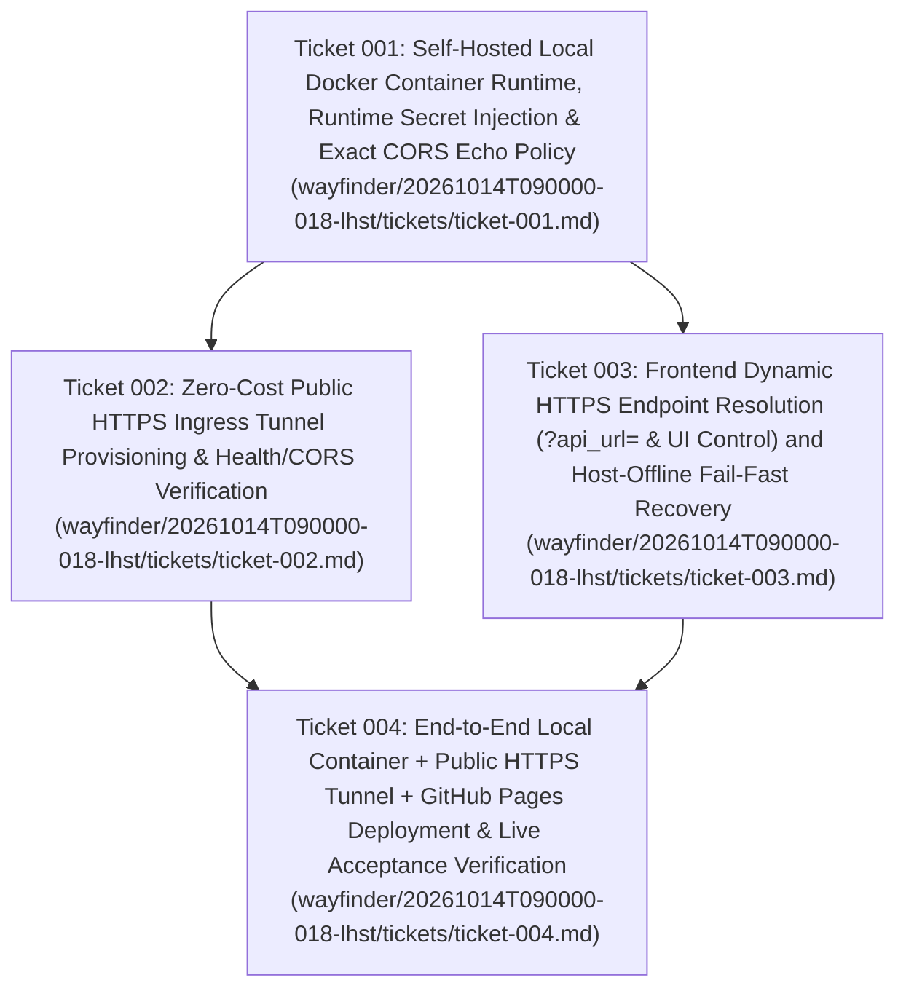

# Wayfinder Architectural Roadmap (`20261014T090000-018-lhst`)

- **Run ID:** `20261014T090000-018-lhst`
- **Governing Specification:** [`functional_specification_018.md`](file:///Users/diesel/desktop/lag/functional_specification_018.md)
- **Glossary Reference:** [`LANGUAGE.md`](file:///Users/diesel/desktop/lag/LANGUAGE.md)

---

## 1. Destination

Deliver the complete, production-verified self-hosted local container runtime and public HTTPS ingress architecture defined in [`functional_specification_018.md`](file:///Users/diesel/desktop/lag/functional_specification_018.md):
1. **Self-Hosted Local Container Runtime (`lag-policy-engine-local`):** Isolated local Docker container executing on the operator's host machine at zero recurring platform cost, serving the complete 8-hop knowledge graph (`3,875` nodes across 17 categories, `7,593` edges across 18 relationship types for `{Policy Keyword}` `"LTA"`) via `NEO4J_URI="embedded://exports/lta_knowledge_graph.json"`, with runtime environment credentials (`HF_TOKEN` / `HUGGINGFACE_API_KEY` preserving the `ACT-KG-` credential for live LLM synthesis, and `CONGRESS_API_KEY`) injected exclusively at container startup and zero secrets in `Dockerfile`, `docker-compose.yml`, or Git history.
2. **Public HTTPS Ingress & Exact CORS Policy (`lag-policy-engine-tunnel`):** Companion Cloudflare Quick Tunnel container (`cloudflare/cloudflared:latest`) attached to the local container network (`lag-net`) exposing standard TLS (port 443) public HTTPS ingress (`https://*.trycloudflare.com`), paired with `CORSMiddleware` returning `Access-Control-Allow-Origin: https://luisp1028.github.io` on preflight `OPTIONS` and cross-origin `GET`/`POST` requests.
3. **Frontend Live API Binding, Runtime `?api_url=` Reconfiguration & Offline Fail-Fast Telemetry (`https://luisp1028.github.io/lag-policy-engine-showcase/`):** Public GitHub Pages showcase defaulting to **Live API Mode** (`dataSourceMode = "live"`) bound to the active public HTTPS tunnel URL, supporting runtime URL query parameter override (`?api_url=https://...`) and interactive UI endpoint configuration for ephemeral tunnel rotation, and enforcing strict fail-fast error telemetry (`▲ EXECUTION ERROR` badge and `data-testid="backend-error-banner"`) with explicit user recovery actions (`Retry Live API`, `Load Pre-computed LTA Snapshot`, `Load Pre-computed IVIG Snapshot`) when the host computer or local container is offline.

---

## 2. Notes & Execution Override

- **Execution Override:** Per operator instruction (`"Read over @functional_specification_018.md and use /wayfinder to implement edits outlined"`), this Wayfinder effort carries full implementation, container orchestration, public HTTPS ingress provisioning, GitHub Pages deployment, and end-to-end verification into the map and its tickets.
- **Taxonomy Compliance (`LANGUAGE.md`):** Every evaluation of `{errors}`, `{correctness}`, `{functionality}`, `{correct required outputs}`, `{sufficient}`, and `{insufficient}` adheres strictly to [`LANGUAGE.md`](file:///Users/diesel/desktop/lag/LANGUAGE.md).
- **Zero-Fallback & Secret Isolation Mandate:** Zero hardcoded credentials in any tracked file or container image layer; zero silent fallback to static data when in Live API mode.

---

## 3. Ticket Dependency DAG

---

## 4. Decisions So Far

1. **[Ticket 001 — Self-Hosted Local Docker Container Runtime, Runtime Secret Injection & Exact CORS Echo Policy](file:///Users/diesel/desktop/lag/wayfinder/20261014T090000-018-lhst/tickets/ticket-001.md) (Resolved):**
   - Updated `CORSMiddleware` in [`src/api/server.py`](file:///Users/diesel/desktop/lag/src/api/server.py) by removing wildcard `"*"` from `allow_origins` and configuring explicit `allow_origins` (`https://luisp1028.github.io`, `http://localhost:3000`, `http://localhost:5173`, `http://127.0.0.1:3000`, `http://127.0.0.1:5173`) plus `allow_origin_regex=r"https://.*\.github\.io|https://.*\.trycloudflare\.com|https://.*\.hf\.space|http://localhost(:\d+)?|http://127\.0\.0\.1(:\d+)?"` so `OPTIONS` preflight requests from `Origin: https://luisp1028.github.io` deterministically return `access-control-allow-origin: https://luisp1028.github.io`.
   - Added [`docker-compose.yml`](file:///Users/diesel/desktop/lag/docker-compose.yml) and [`src/deploy/deploy_local_container.py`](file:///Users/diesel/desktop/lag/src/deploy/deploy_local_container.py) to build `lag-policy-engine:local` from [`Dockerfile`](file:///Users/diesel/desktop/lag/Dockerfile) with zero embedded secrets and start `lag-policy-engine-local` with runtime `.env` injection (`HF_TOKEN`, `HUGGINGFACE_API_KEY`, `CONGRESS_API_KEY`) while forcing `NEO4J_URI="embedded://exports/lta_knowledge_graph.json"` inside the container.
2. **[Ticket 002 — Zero-Cost Public HTTPS Ingress Tunnel Provisioning & Health/CORS Verification](file:///Users/diesel/desktop/lag/wayfinder/20261014T090000-018-lhst/tickets/ticket-002.md) (Resolved):**
   - Provisioned companion container `lag-policy-engine-tunnel` (`cloudflare/cloudflared:latest tunnel --no-autoupdate --url http://lag-policy-engine-local:7860`) on shared Docker bridge network `lag-net`, exposing standard TLS (port 443) public HTTPS ingress at zero cost without VPNs or custom certificates.
   - Automated tunnel URL extraction and live readiness polling in [`src/deploy/deploy_local_container.py`](file:///Users/diesel/desktop/lag/src/deploy/deploy_local_container.py).
3. **[Ticket 003 — Frontend Dynamic HTTPS Endpoint Resolution (`?api_url=` & UI Control) and Host-Offline Fail-Fast Recovery](file:///Users/diesel/desktop/lag/wayfinder/20261014T090000-018-lhst/tickets/ticket-003.md) (Resolved):**
   - Updated [`src/frontend/src/utils/apiConfig.ts`](file:///Users/diesel/desktop/lag/src/frontend/src/utils/apiConfig.ts) to resolve the live API base URL with strict precedence: (1) `?api_url=` URL query parameter, (2) interactive UI runtime override (`setRuntimeApiBaseUrl`), (3) build-baked `VITE_API_BASE_URL`, (4) `DEFAULT_PUBLIC_INGRESS_URL` on `*.github.io`, and (5) `""` on local development.
   - Updated [`src/frontend/src/components/FilterToolbar.tsx`](file:///Users/diesel/desktop/lag/src/frontend/src/components/FilterToolbar.tsx) and [`src/frontend/src/App.tsx`](file:///Users/diesel/desktop/lag/src/frontend/src/App.tsx) to include an interactive `API ENDPOINT` configuration control (`data-testid="api-url-config-btn"`, `data-testid="api-url-input"`, `data-testid="api-url-apply-btn"`) and explicit offline fail-fast recovery controls (`Retry Live API`, `Load Pre-computed LTA Snapshot`, and `Load Pre-computed IVIG Snapshot`).
4. **[Ticket 004 — End-to-End Local Container + Public HTTPS Tunnel + GitHub Pages Deployment & Live Acceptance Verification](file:///Users/diesel/desktop/lag/wayfinder/20261014T090000-018-lhst/tickets/ticket-004.md) (Resolved):**
   - Updated [`src/deploy/deploy_github_pages.py`](file:///Users/diesel/desktop/lag/src/deploy/deploy_github_pages.py) and [`src/deploy/deploy_all.py`](file:///Users/diesel/desktop/lag/src/deploy/deploy_all.py) to orchestrate local container + HTTPS tunnel provisioning, build and deploy the static bundle with the active public HTTPS tunnel URL to `LuisP1028/lag-policy-engine-showcase`, verify all 7 endpoints + CORS + live GraphRAG synthesis (`ACT-KG-` credential) over the public HTTPS tunnel, and persist telemetry to [`src/deploy/deployment_manifest.json`](file:///Users/diesel/desktop/lag/src/deploy/deployment_manifest.json).

---

## 5. Not Yet Specified (Fog of War)

None. All 4 architectural decision tickets are resolved and verified against [`functional_specification_018.md`](file:///Users/diesel/desktop/lag/functional_specification_018.md).

---

## 6. Out of Scope

- Paid cloud compute tiers on Hugging Face Spaces or external managed Neo4j Aura subscriptions.
